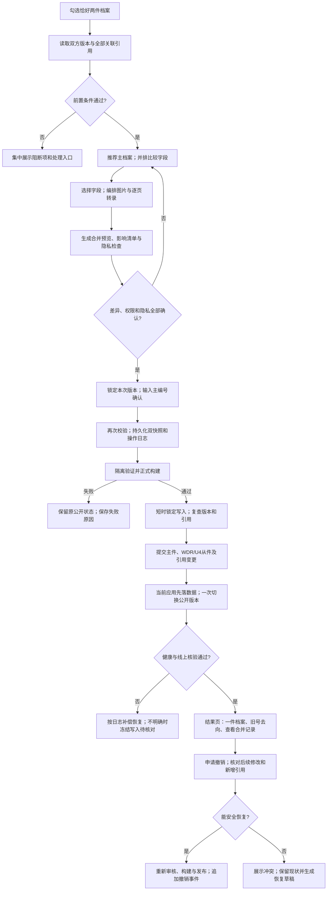

# 档案管理页「将两件档案合并为一件」功能方案

版本：v2.0，2026-10-24。本文是可实施设计，不表示通用合并按钮和接口已经开发上线。本次指定的LET-019/020另以受控维护任务执行，最终结果记在开发日志。

适用现状：档案采用JSON、core/metadata/public_view、发布副本inbox、草稿、历史和WDR/U4正式撤销；账号收藏使用独立的现有SQLite，点赞使用独立JSON。沿用本机维护入口及已批准的线上管理员鉴权，不增加数据库、CMS、服务或依赖。字段和代码以项目Excel标准及其生成字典为准。

## 一、功能流程图



### 1. 合并对象和前置校验

- **语义先于相似度**：合并表示原来误分的同一件/同一套资料。仅同作者、同主题、同一相册、版式相似不能自动合并；一册内的独立照片通常通过相册归集，仍逐件计数。本次是所有人明确指定的两页家信，不依笔迹寻找或坐实真实身份。
- 首版限定恰好两件现有正式记录、同object_type及metadata.schema；均为ACT/G/U3、无草稿、无未完成操作。混合草稿与正式、已撤销、正在恢复、已合并从件均阻断。后续支持草稿合并时单设“保存合并草稿”，仍为SUS/Y/U0，不借合并自动发布。
- 双方必须存在、编号合法、图片齐全，字段、字典及收藏编码有效；磁盘、路径权限、快照空间和构建环境通过检查。已有草稿须先保存、发布或留存备份后明确处理，不能静默覆盖。
- **全宗/来源**：有正式全宗字段时必须相同且操作人有双方权限；本项目没有fonds_code，不能把collection_id冒充全宗。实际使用已有collection_id、album_id、series_id和来源证据辅助核对；两边均未填不代表已确认同源，须记录所有人确认或具体证据。组合归属不同须先人工解决，不能自动清空。
- **保管期限、密级**：当前标准未维护这些字段，界面标明“本库未接入此管理项”，不能伪造默认代码或假装已通过。机构场景接入后须用正式字典：不同期限/密级默认阻断；只有明确的机构政策及有权人员批准，才可取更长保存期、更严格访问范围。未知不等于较低；不比较代码字母顺序，也不覆盖保密/法律保全要求。
- 借阅未归还、审批/流转进行中、已移交导致无管理权、已销毁、司法保全、资料占用均阻断。借阅/审批模块当前不存在，不显示“0条、已校验”；扩展适配器必须区分“不适用、已校验、未接入、未知”。应有业务却未接入时不得放行。
- 公开权利与隐私范围必须兼容。OWN仅表示所有权，不自动等于版权或下载许可。即使两件各自已公开，拼接后也须复查姓名、地址、编码及上下文新增的识别风险；13项确认绑定本次合成图文，不默认为已确认。
- 阻断自合并、重复合并、循环关系。历史主件可再次作为主件，但必须先解析已有合并链、全部旧号别名及撤销依赖；首版不支持把既有主件再作为从件，不允许制造链式跳转或绕过历史。

### 2. 主档案、从档案及计数

- 系统先推荐已有稳定外部引用、完整著录和正文首页的一件；其次比较实际建档时间，再以编号作稳定排序。永久编号大小不能当成页序或日期证据。允许切换主档案，但必须重新生成附件路径、引用影响、字段默认值和审核版本；保留推荐及人工选择理由。
- 主件沿用自身item_id、入藏日期和历史，不造新号、不改旧号。另一编号永不回收；从件按**WDR/U4**正式撤销，保留原记录、转录、图片快照与明确合并原因。合并状态放入私密操作日志，不新增Excel字典中没有的merged档案代码。
- 管理页提供“已合并留档”筛选和只读横幅；公开目录只显示主件。旧详情地址按语言跳到主件，或显示合并去向说明，不再呈现第二件独立档案。采用可撤销的302并禁止缓存；旧图像锚点映射到合并后的对应页，不一律指向第1页。
- 活跃馆藏/公开件数由两件变一件；附件数量按实际保留图像计算。本次为一件、两页影像，不能推定两张实体纸，也不能把“图片页数”当成“档案件数”。历史收件量、操作事件不改写；当前、历史时点、已撤销留档分别统计。相册、搜索、类别、首页和多语言共用同一有效记录集合。

## 二、数据结构与接口

### 1. 文件与记录

| 数据 | 存储及约束 |
|---|---|
| 正式记录 | 继续使用archive-data/永久编号.json；主件按标准更新，从件WDR/U4，保留历史 |
| 预览方案 | 私密merges/plans/planId.json，保存双方版本、选值、附件顺序和引用摘要；不进Git/公开目录 |
| 合并日志 | 本机local-admin/merges/mergeId/；服务器DATA/merges/mergeId/。版本化JSON，不引入新档案数据库 |
| 历史快照 | 继续使用history/编号/entryId/record.json、images和manifest；复制后逐文件校验，保留恢复能力 |
| 公共别名投影 | 仅旧ID、目标ID、允许的图片序号映射；不包含旧全文、账号、内部原因或私密来源路径。由已提交日志生成，不维护第二套手工清单 |
| 账号、点赞等 | 留在各自现有业务存储；用同一mergeId关联私密迁移审计，绝不塞入core或metadata |

```json
{
  "schema_version": 1,
  "merge_id": "UUID",
  "primary_id": "LJM-20260910-LET-020",
  "secondary_id": "LJM-20260910-LET-019",
  "status": "prepared",
  "operator": {"subject": "由服务端鉴权取得", "mode": "local-or-online"},
  "authorized_scope": "本次两件及明确公开/撤销范围",
  "before": {"record_revisions": {}, "image_hashes": {}, "references_digest": "SHA256"},
  "decisions": [{"path": "core.title", "strategy": "custom", "reason": "整合两页内容"}],
  "attachment_map": [{"source_item_id": "…019", "source_filename": "front-public.jpg", "target_filename": "back-public.jpg", "position": 2, "sha256": "…"}],
  "snapshots": [{"item_id": "…", "entry_id": "…", "manifest_sha256": "…"}],
  "after": {"record_hashes": {}, "public_release": "…", "alias_digest": "…"},
  "events": [{"phase": "prepared", "at": "ISO时间", "result": "通过"}],
  "undo": {"status": "available", "last_checked_at": null}
}
```

- 状态为操作日志自己的prepared/committing/committed/failed/needs_review/reverted；与档案ACT/WDR等字典分开。事件追加、不抹掉失败尝试。快照正文独立私密保存，日志仅记录相对引用和摘要；操作收据仍沿用现有白名单摘要，不写全文和个人号码。
- 记录实际执行者、授权依据、操作时间、计划/规则版本、双方修改前后摘要、字段选择及理由、文件映射、引用变更、构建/公开版本、回退结果。客户端不能伪造operator或指定任意磁盘路径。

### 2. 字段合并策略与默认值

- **不使用一条全局“主空取从”规则覆盖所有字段。** 先区分缺失、明确未知、不适用和有值。0、false、空数组、字典未知码分别按类型解释；EV-UNK等不是可以随意覆盖的空值。主字段缺失/未知、从字段有直接证据时可预选“建议补入”，仍显示来源供确认；无依据时使用该字段正式未知码或保留空缺。必填项无合法未知值时阻断，不填“无”冒充已核查。
- 单值冲突必须明确选主、选从、按证据重写或保留未知；不把两个地点/日期拼成不合规范的单值。多值仅在字典声明允许时去重并集，保留来源。转录原文不因去重、繁简转换或自动纠错改变。
- 永久item_id不变；collection_code由最终属性按现有规则重算。旧题名、旧日期保存在快照及决策日志；不新增alt_titles、alt_dates等未经标准定义的core字段。
- **责任者**：本库无通用creator字段，不把core.people误作作者。仅按实际类型使用PC15.creator_name、DN04.creator_name等已有字段；不依据人脸、笔迹或署名候选推断普通人身份。没有可公开依据则不补真实姓名。
- **页数**：本库LET没有通用pages字段，界面页数按最终图像计算；实体页数/张数只有证据和适用schema时填写，如DN15.leaf_count。同一页重复图不累加，未拍背面不算已知空白，不能用max(两条页数)。

下表覆盖当前86个通用标准字段；collection_code及public_view另列。实际显示的每个字段均可查看其规则；后续字典新增字段而未配置策略时，服务端阻断而非静默沿用默认。

表格是策略索引，不要求每件填满所有字段。实际对比页按类型适用范围、现有字段路由和schema展示；不把照片等专属维度平铺到信件，不为不适用字段强填未知码。专属字段策略由维度定义、字段类型和字典生成清单：共用规范字段引用本表、遮盖字段使用隐私策略、转录按图像整理、数量/尺寸需证据，其他单值默认人工确认；未能确定类型或策略的字段阻断，不静默取主值。

| 通用字段 | 冲突及默认规则 |
|---|---|
| 档案状态 `record_status` | 由操作阶段决定；当前公开合并主件ACT、从件WDR。不得引入merged代码；草稿方案不先改公开状态。 |
| 单件唯一编号 `item_id` | 恒保留选定主件永久号；从号留档、不回收、不复用。 |
| 批次编号 `batch_id` | 主件保留；不同批次须确认原始组合，另方批次在快照/来源日志保留，不伪造新批次。 |
| 入藏日期 `accession_date` | 保留主件实际入藏日期，须与永久号含义一致；从件不同日期留来源记录，不能改成拍摄/书写日期。 |
| 资料类型 `object_type` | 首版必须一致；按正式字典校验且匹配schema，不因合并改变永久号。 |
| 批内序号 `item_seq` | 主件批内序号保留，不用来表示最终图片页序，也不与从件序号相加。 |
| 题名 `title` | 预置保留主题名，要求核对并可重写为整件题名；旧标题入快照，不新增未定义alt_titles字段。 |
| 显示年代 `date_display` | 相同保留；矛盾或确定度不同按证据人工选，可依法定格式写约值/时间段；无据填“年代未知”。 |
| 时间起点 `date_start` | 仅在确有形成时段依据时组合；同一封信不能把入藏时间或两种互斥猜测取min/max拼成时间段，未知留空。 |
| 时间终点 `date_end` | 仅在确有形成时段依据时组合；同一封信不能把入藏时间或两种互斥猜测取min/max拼成时间段，未知留空。 |
| 时间判断说明 `time_notes` | 按来源整合日期依据和疑读；说明未采纳值，不将疑读年份变为确证。 |
| 地点代码 `place_code` | 单值字典冲突人工选；不拼接代码，不把通信地址或工作背景直接当形成地点，无据按字典未知/留空。 |
| 国家/地区 `country` | 逐级按同一地点证据处理；单值冲突人工选并校验层级，不造跨省城市组合；私人精确位置不进入公开字段。 |
| 省级 `province` | 逐级按同一地点证据处理；单值冲突人工选并校验层级，不造跨省城市组合；私人精确位置不进入公开字段。 |
| 市级 `city` | 逐级按同一地点证据处理；单值冲突人工选并校验层级，不造跨省城市组合；私人精确位置不进入公开字段。 |
| 区县 `district` | 逐级按同一地点证据处理；单值冲突人工选并校验层级，不造跨省城市组合；私人精确位置不进入公开字段。 |
| 街道/乡镇 `street_town` | 逐级按同一地点证据处理；单值冲突人工选并校验层级，不造跨省城市组合；私人精确位置不进入公开字段。 |
| 具体地点 `specific_place` | 逐级按同一地点证据处理；单值冲突人工选并校验层级，不造跨省城市组合；私人精确位置不进入公开字段。 |
| 地点说明 `place_notes` | 整合地点证据及未知原因；区分写信地、通信地和工作地，不放完整私人地址。 |
| 人物编号 `person_ids` | 只合并已确认、可公开且同一实体字典的编号；不据照片/姓名联想新身份，疑似重复交人工处理。 |
| 人物姓名 `people` | 现有可公开值去重后逐项核对；不把正文里被遮盖的名字补入，不拿此字段代替责任者。 |
| 人数 `people_count` | 不相加不同照片中的人数；按整件定义和去重证据填写，无法统一时保留未知/原值并说明。 |
| 人物关系 `relationships` | 仅保留有直接依据且可公开的现有多值，不依据人脸或背景推断真实关系/身份；疑问不补。 |
| 人物身份 `identities` | 仅保留有直接依据且可公开的现有多值，不依据人脸或背景推断真实关系/身份；疑问不补。 |
| 机构编号 `organization_ids` | 同一字典/同一机构范围内去重并集，核对历史单位名；不同角色在说明中区分，不误作作者。 |
| 机构/单位 `organizations` | 同一字典/同一机构范围内去重并集，核对历史单位名；不同角色在说明中区分，不误作作者。 |
| 事件/场景代码 `event_scene` | 只对字典允许多值做去重并集；新标签须有整件内容依据，无据用该字段正式未知码。 |
| 主题代码 `themes` | 只对字典允许多值做去重并集；新标签须有整件内容依据，无据用该字段正式未知码。 |
| 照片功能 `photo_function` | 按适用schema及字典人工解决单值冲突；多场景不能取“信息更完整”的值覆盖全部。 |
| 拍摄形式 `shot_form` | 按适用schema及字典人工解决单值冲突；多场景不能取“信息更完整”的值覆盖全部。 |
| 摄影来源 `photography_source` | 按适用schema及字典人工解决单值冲突；多场景不能取“信息更完整”的值覆盖全部。 |
| 照相馆/摄影者 `studio_photographer` | 可公开且有依据的现有数组并集；不把署名候选当成确定摄影者，不补真实身份。 |
| 载体 `carrier` | 按正式类型定义处理；异质部件不简单选最大/最常见值，无法归一时依字典未知并在尺寸/材料说明保留差异。 |
| 色彩 `color` | 按正式类型定义处理；异质部件不简单选最大/最常见值，无法归一时依字典未知并在尺寸/材料说明保留差异。 |
| 工艺 `process` | 按正式类型定义处理；异质部件不简单选最大/最常见值，无法归一时依字典未知并在尺寸/材料说明保留差异。 |
| 宽度(mm) `width_mm` | 同一被测实体才可比较；不同纸页尺寸不取较大值冒充整件，未测不写0或凭图片比例估算。 |
| 高度(mm) `height_mm` | 同一被测实体才可比较；不同纸页尺寸不取较大值冒充整件，未测不写0或凭图片比例估算。 |
| 尺寸备注 `size_notes` | 按部件或影像来源分段说明差异；明确实体尺寸/张数尚未测定，不将图像数冒作实体页数。 |
| 背面信息类型 `verso_types` | 只合并确认是实物背面的证据；back文件名不等于背面；未提供不填VS-NONE，不扩张既有特定批准。 |
| 背面文字转录 `verso_transcription` | 与确认的背面图片/部件对应整理，保留疑读及遮盖；不能把任意第2页当实物背面文字。 |
| 印章/标记类型 `mark_types` | 依正式字典多值去重并集，逐项核实标记，不根据类似印痕猜造代码。 |
| 印章/标记转录 `mark_transcription` | 分来源转录已确认标记；保留疑读，签名/编码仍遮盖，不从两份遮盖片段恢复全文。 |
| 获得方式 `acquisition_method` | 相同保留；不同时保留主件值并记录双方来源，需人工确认不能拼代码。 |
| 来源人/机构 `source_name` | 主件来源为缺省，另一来源进入私密来源/快照说明；不把未知换成推断，来源人隐私仍受门禁。 |
| 获得日期 `source_date` | 主件来源为缺省，另一来源进入私密来源/快照说明；不把未知换成推断，来源人隐私仍受门禁。 |
| 获得地点 `source_place` | 主件来源为缺省，另一来源进入私密来源/快照说明；不把未知换成推断，来源人隐私仍受门禁。 |
| 流传经历 `provenance_notes` | 按先后及来源整合经历，明确已知/推测/未知；不泄露私人联系方式或主库路径。 |
| 组合编号 `collection_id` | 相同保留；不同或一方缺失时必须核对组合关系后选择，不能一律并集或清空；相册其他成员影响单列。 |
| 相册编号 `album_id` | 相同保留；不同或一方缺失时必须核对组合关系后选择，不能一律并集或清空；相册其他成员影响单列。 |
| 系列编号 `series_id` | 相同保留；不同或一方缺失时必须核对组合关系后选择，不能一律并集或清空；相册其他成员影响单列。 |
| 原始位置/次序 `original_position` | 保留原始位置文字证据并注明来源；最终显示页序另由附件顺序决定，不反写成原始页号。 |
| 关联单件编号 `related_item_ids` | 精确编号并集、去重、去自引用，解析被合并旧号；检查循环及外部反向引用，受影响记录另留快照。 |
| 保存等级 `condition_grade` | 仅有真实评估才归一；不凭两条记录取较好值，未知不当作较好；部件差异须说明，无法评估保留未知。 |
| 保存问题代码 `condition_details` | 经字典校验后并集，并说明问题属于哪一页/部件，不把一页损坏泛化为全部。 |
| 保护处理说明 `treatment_notes` | 按来源和原日期保留已实施处理；不因合并虚构清洁、修复或脱敏工序已完成。 |
| 隐私等级 `privacy_level` | 按合成内容重新评估；G/Y/R不可因合并自动降级。未经有效整体确认不能设G并公开。 |
| 权利状态 `rights_status` | 采用兼容的更严格使用范围并人工确认；冲突未解决阻断。OWN不等于版权或下载许可，不按代码排序。 |
| 研究状态 `research_status` | 不因拼接自动标完成；依实际核查程度及字典选值，未核结论继续待核。 |
| 证据等级 `evidence_level` | 按最终关键结论的证据评估，不能取较高等级覆盖薄弱结论；各字段证据差异保留说明。 |
| 证据依据 `evidence_basis` | 逐项说明合并结构、日期、地点及材料依据，来源可追溯；不能以“AI判断”代替证据。 |
| 研究备注 `research_notes` | 按来源保留研究争议及未采纳意见；内部备注不直接拼进公开描述。 |
| 最近研究日期 `last_research_date` | 仅反映实际已完成研究/核查的日期，不因执行合并自动改成已全面研究；有依据时再更新。 |
| 数字化状态 `digitization_status` | 按最终所有部件的真实数字化完整性重评；一件已数字化不能遮盖另一件缺图。 |
| 扫描日期 `scan_date` | 不取最大值作为全部扫描参数；不同副本的真实参数分别保留，来源未知不把2000px发布尺寸当扫描分辨率。 |
| 扫描分辨率(ppi) `scan_ppi` | 不取最大值作为全部扫描参数；不同副本的真实参数分别保留，来源未知不把2000px发布尺寸当扫描分辨率。 |
| 主文件路径 `master_file_path` | 公开发布记录禁止；发现此值应阻断公开并清理发布投影，原主档不移动也不覆盖。 |
| 访问副本路径 `access_file_path` | 仅保留明确允许的访问副本引用；不把未脱敏副本、桌面路径或主档自动带入公开层，未知留空。 |
| 发布副本路径 `publication_file_path` | 由服务器按审核附件顺序生成主编号路径；inbox接收已批准副本，同名不覆盖，复制后摘要一致。 |
| 转录状态 `transcription_status` | 合并后有逐页转录才按字典标已转录；已校对须整件实际校对，不能继承另一半的较高完成状态。 |
| 备份状态 `backup_status` | 只在此次备份实际落盘并通过校验后依字典更新；不因有旧快照默认全部备份完成。 |
| 校验和(SHA-256) `checksum_sha256` | 原摘要对应原文件，入快照；合并后逐文件摘要存附件清单/操作日志。不拼接两串SHA，字段定义未明确为合并包时不能擅自改变其语义。 |
| 文件命名备注 `filename_notes` | 记录原来源→规范新名和页序关系；不含原主库绝对路径，不声称back必为实物背面。 |
| 使用状态 `use_status` | 公开审核完成主件U3、从件正式撤销U4；保存方案或恢复草稿不提前改变公开状态。 |
| 作品/项目 `use_project` | 结构化引用去重并保留原来源；旧公开地址通过合并映射处理，无法识别的引用先核对。 |
| 发布链接/出处 `publication_reference` | 结构化引用去重并保留原来源；旧公开地址通过合并映射处理，无法识别的引用先核对。 |
| 物理位置 `physical_location` | 主件位置为缺省，部件不同位置必须如实登记差异并确认；不把两盒字符串拼成一个合法盒号，未知不虚填。 |
| 盒号 `storage_box` | 主件位置为缺省，部件不同位置必须如实登记差异并确认；不把两盒字符串拼成一个合法盒号，未知不虚填。 |
| 袋/套号 `storage_sleeve` | 主件位置为缺省，部件不同位置必须如实登记差异并确认；不把两盒字符串拼成一个合法盒号，未知不虚填。 |
| 建档人 `record_creator` | 主件原建档人/时间不改；从件原值留快照，本次实际操作者和时间写操作日志。 |
| 建档日期 `created_date` | 主件原建档人/时间不改；从件原值留快照，本次实际操作者和时间写操作日志。 |
| 更新日期 `updated_date` | 现有接口按实际维护日期更新，不写成入藏日期或纸本文献形成日期。 |
| 下一步唯一动作 `next_action` | 根据合并后仍待核事项重新明确下一步与复核日期，不能拼出多个互斥“唯一下一步”。 |
| 复盘日期 `review_date` | 根据合并后仍待核事项重新明确下一步与复核日期，不能拼出多个互斥“唯一下一步”。 |
| 综合备注 `notes` | 保留必要来源说明，追加从号去向及合并依据；不复制完整敏感号码、主档路径或账号数据。 |
| ID校验 `id_check` | 执行真实编号、schema、字段、隐私、图片和构建检查后由系统生成；旧“检查通过”文字不能当成新检查结果。 |
| 必填校验 `required_check` | 执行真实编号、schema、字段、隐私、图片和构建检查后由系统生成；旧“检查通过”文字不能当成新检查结果。 |

| 其他字段/类型 | 规则与缺省 |
|---|---|
| core.collection_code | 根据最终object_type、date_display及规定维度重算；不手改、不拼接永久号 |
| public_view.description | 根据合并后的整件内容重写；不简单拼两段互相矛盾的“残页”描述，保留未知与隐私说明 |
| public_view.transcription | 对应最终图片逐页整理，只保留原文，不混入释义、标题稿；去掉重复整理说明，疑读/缺字/遮盖保留。重复段落不自动删，除非确认是相同影像 |
| public_view.tags | 去重并集后人工清理过时的“残页”等标签；不增加可以坐实身份的关键词 |
| public_view.image_descriptions | 严格与最终图片一一对应，重写总页数和顺序；back命名不能被解释为已确认实体背面 |
| public_view.revision_note | 简要说明合并与页序变化，面向访客；不写内部路径、账号和敏感撤下原因 |
| D01-D21、PC01-PC21、DN01-DN21、ID01-ID21、CD01-CD21 | 先要求object_type/schema一致，再按该schema字段类型、正式字典和必填维度逐字段处理：相同保留、证据明确的缺项建议补入、多值按允许范围并集、单值差异人工选；未知不等于不适用 |
| 人数、尺寸、保存状况 | 同人多图不相加人数；不同纸页尺寸不取较大冒作全部尺寸；多部件差异用说明/附件注释保留，无法合法归一时保留未知，不伪造通用数组字段 |
| 证件/卡片masked字段 | 不拼接两份不同遮盖片段，不从一份补齐另一份被遮位置；选更保护隐私的表示或重新脱敏。完整号码和私人地址仍不得进公开数据 |

### 3. 附件、全文与关联数据

| 对象 | 迁移或解析策略 |
|---|---|
| 主档、TIFF/RAW、原始TXT | 始终只读，禁止移动、覆盖、删除或为了合并复制到公开层；只有已确认发布副本可从inbox入站 |
| 发布图片 | 默认保留双方全部有效附件；源文件复制到主件空闲规范文件名，绝不移动唯一副本或覆盖同名。先比较SHA256；同名异内容分配新名并提示。相同摘要可建议去重，用户确认保留页序和图注后才采用；近似图、不同脱敏版本不自动当重复 |
| 电子全文、OCR | 建立sourceItemId/sourceImageId→最终页号映射，逐页对应图片；完整度、来源及疑读保留。不同译文或校对版本不直接串成重复全文，单独列冲突。原稿、旧转录入私密快照 |
| 原公开副本与缓存 | 从件正式撤销后按现有机制撤出公开目录，保留inbox和历史；旧缩略图同步撤下。合并去向跳转不代表所有旧图片均可继续公开；图片别名须逐文件核准 |
| 相册/组合/相关档案 | 不同相册归属先解决；重排album页号须预览其他成员影响。related_item_ids精确去重、去自引用、改指生效主件；影响到的其他正式记录也须快照及版本校验。不做全文字符串替换 |
| 账号收藏 | 按用户把从ID收藏解析到主ID，双收藏去重并保留最早收藏时间；在独立账号审计中保留可逆迁移证据，不改账号主体、登录会话或投稿归属。已注销账号不因撤销合并而被恢复；账号数据按现有保留/注销规则处理 |
| 点赞 | 当前匿名标识含item_id，跨两件的旧哈希不能确认是否同一人。不得把集合并集/相加冒作“去重人数”。首版没有兼容方案时非零点赞阻断；接入后保留两份历史统计并明确未去重，后续新赞使用规范主ID，具体展示口径另行确认。本次两件均0赞，无需改写 |
| 浏览足迹/浏览器本地数据 | 服务器不能替所有浏览器改localStorage；下次访问用公开别名映射解析旧ID并去重展示，不上传用户历史 |
| 借阅、流转、审批历史 | 进行中业务阻断；完成的原事件保留原编号、当时题名与决定，不篡改历史；新增合并关联，通过effective_item_id/别名解析当前对象。未来适配器须列出每条引用和可逆变更，未接入不能承诺迁移 |
| 投稿、导出/注销申请 | linked_item_id、提交人归属、撤回权、请求范围独立核对；不能借合并绕过投稿撤回或换所有人。未有适配器的关联投稿先阻断；已完成导出保留其当时快照，新导出显示合并关系，不能宣称已收回外部副本 |
| 专题、展览、引用链接、二维码 | 已知结构化引用改指/解析主件并保留原引用；未知引用类型阻断。站外链接无法逐一编辑，六语言旧详情保留去向；旧页锚点映射到正确新页 |
| 搜索、多语言、SEO、统计 | 统一从最终有效档案重建。旧ID退出公开目录、搜索和sitemap，别名不计新件；新主件canonical唯一。翻译按现有来源字段哈希失效机制处理，只影响变化字段，不把旧两段译文冒作新合并全文，不清空其他档案译文 |

### 4. 接口契约

沿用现有写入协议2：受信任Origin、X-LJM-Admin-Request: 1、X-LJM-Operation-Id与X-LJM-Step-Id（UUID），以及expectedRevision；线上还需现有管理员鉴权。业务接口均no-store，收据不泄露正文。以下为拟新增接口，当前尚不存在。

| 接口 | 核心入参 | 主要出参 |
|---|---|---|
| POST /api/merge-preflight | itemIds恰好2个 | pass、双方revisions、推荐主件/理由、blockers[]、warnings[]、各引用模块availability/count/digest |
| POST /api/merge-plan | primaryId、secondaryId、expectedRevisions、fieldChoices、attachmentOrder、referenceDecisions | planId、planRevision、字段及图文预览、未决项、计划摘要、影响数量 |
| POST /api/merge-review | planId、planRevision | reviewId、两件版本/图像/引用/规则/计划摘要、13项清单、有效期；任何变化使确认失效 |
| POST /api/merge | 下方示例；绑定操作者 | 成功200：mergeId、主/从ID、主URL、WDR/U4、publicRelease、统计变化、warnings；在途用现有操作查询 |
| GET /api/operations/{operationId} | 现有操作ID，须鉴权 | queued/running/succeeded/failed/needs_review等现有收据状态和安全摘要；网络超时先查此结果，不能盲目重发 |
| GET /api/merges、GET /api/merges/{mergeId} | 分页/mergeId | 权限过滤后的合并记录、决策、快照列表、当前可撤销性及阻断原因 |
| POST /api/merge-undo-review | mergeId及当前版本 | 撤销影响、合并后的新修改/引用冲突、恢复预览及新的审核令牌 |
| POST /api/merge-undo | mergeId、expectedRevisions、undoReviewId、confirmations、明确的恢复发布范围 | 新的撤销操作ID、恢复后的两个编号/状态/公开版本；不重用旧合并幂等键 |

```json
{
  "planId": "UUID", "planRevision": 3,
  "primaryId": "LJM-20260910-LET-020", "secondaryId": "LJM-20260910-LET-019",
  "expectedRevisions": {"LJM-20260910-LET-020": "SHA256版本", "LJM-20260910-LET-019": "SHA256版本"},
  "reviewId": "UUID", "confirmPrimaryId": "LJM-20260910-LET-020",
  "confirmations": [true, true, true, true, true, true, true, true, true, true, true, true, true],
  "publicationAuthorization": {"publishMergedPrimary": true, "withdrawSecondary": true}
}
```

- fieldChoices仅允许标准字段路径及服务器支持的策略，禁止__proto__等路径、任意文件路径、客户端自填永久号。数组、日期、枚举、单位和必填值按类型验证；附件用服务器签发的源文件引用、摘要和顺序，不接收任意from/to磁盘路径。
- 只在服务端产生mergeId、operator和真正时间。reviewId建议沿用现有30分钟有效期；这是**确认版本的有效期**，不是撤销记录的保留期限。
- 幂等由现有operationId/stepId及请求摘要控制：同键同参返回首次结果；同键异参409；不同键重复合并同一从件409并返回去向。断网后查询原收据；needs_review不自动重试、不显示成功。

### 5. 提交、并发、失败与撤销

- **不存在跨JSON、图片、账号SQLite、点赞文件及公开软链接的一个数据库事务。** 使用现有写入协调器、私密持久化日志、隔离生成、原子换名及补偿恢复，不引入另一套档案数据库。
- 执行前固化两件记录、草稿、图片、引用明细及字典/代码版本的摘要。先落双快照和可恢复文件，再进行耗时校验/构建；提交前短时取得写入范围并复查，变化即退回对比页。引用摘要不能只比较数量。
- 运行中的管理服务已持数据目录进程租约，不再在同进程抢第二把租约或停止自己。合并写入沿用同一队列；线上部署锁须在进入队列前非阻塞取得，忙则明确返回423，不能持队列等待部署锁。外部CLI则按部署锁→安全停管理服务→取得数据租约的固定顺序。其他发布入口也须遵守同一交接约定，避免与自动部署相互等待。
- 账号/点赞适配器须提供针对这两个ID的短时写入门禁或事务，不能假设档案队列锁住了账号服务。耗时构建不持SQLite写锁；最终引用提交只短时锁定，并以mergeId记录可逆变更。跨存储每一步先写日志再执行；提交中有新关联则重新核对，不静默覆盖。
- 最终顺序：再次校验→当前应用复制新增发布副本→正式主件/从件和引用提交→生成源及别名落入**当前版本**→切换一个已通过检查的公开版本→健康/内容核验→日志committed。图片、JSON、构建任一步不完整不切站。失败恢复双记录、引用、生成源、公开副本、别名及旧live；所有失败现场和快照保留。
- 原子写入必须同时保持owner/group/mode，不能让umask收紧网站配置权限。配置先验证，再以实际服务用户验证可读/可加载，最后重载；失败自动恢复内容与权限，并验证旧服务仍可运行。本次维护已遇到并修复该问题。
- 崩溃恢复：启动扫描未完成合并及现有操作收据，按阶段和摘要对账；若无法证明已提交或已回退，进入needs_review，阻止继续写入。不能简单删除锁、跳过日志或重跑同号操作。
- 撤销没有擅自设定的30天截止期；可否自动撤销取决于快照完整、权限仍有效、后续修改/草稿/新附件/新引用、相册变动及合并依赖。无冲突时按原快照恢复记录和附件、撤销别名并重建；本身也生成新的双快照和审计事件。
- 有后续修改时不覆盖当前主件、不删除新增收藏/点赞；展示三方差异并生成恢复草稿，由有权人决定保留方式。涉及后续合并按依赖逆序处理。复原公开须重新校验隐私和明确公开授权；否则仅生成SUS/Y/U0恢复草稿。账号注销、已销毁材料、不可追回导出等限制单独提示，不能承诺所有关联均可无损逆转。

## 三、前端交互

### 1. 列表选择

- 工具栏文案“将两件档案合并为一件”；只在勾选恰好2件时可用，其余提示“请选择两件档案”。展示“两件变一件；另一编号将留档，可追溯”。不要把“同相册”误作为默认合并理由。
- 选择支持键盘及移动端；离开筛选/分页时明确显示当前仍选中的两件，避免把不可见选中项意外加入。已有未保存表单先保留私密方案再离开。

### 2. 合并对比页

- 顶部两个卡片显示题名、永久号、状态、版本、首图、相册和来源；突出“保留编号/合并后编号”，允许切换主件并说明改变影响。
- 三列“字段 / 两件现值与证据 / 合并后值”，同值可折叠；冲突逐项选、自动建议标“来自哪件/依据”，提供“恢复建议”。用图标和文字区分冲突、未知与不适用，不只用颜色。
- 题名和描述支持编辑并实时预览；证据说明与公开描述分开。底部始终显示“还有N处待处理”，必填冲突未处理不能执行。
- 附件页展示缩略图、来源件号、原文件名、预计新文件名、页序、重复建议和遮盖状态。用拖动及“上移/下移”按钮排序；原图和对应转录并排查看，页序改变同步更新全文页号及图片锚点映射。
- 关联页逐模块显示“可处理/阻断/未接入/不适用”、数量、具体去向与影响；可点开受权限保护的明细。不得把未查询到的模块写成0。公开图文组合重新展示13项检查，默认未勾；有明确委托时记录真正执行人和授权，不伪称所有人亲自核对。

### 3. 确认、执行与结果

- 最终确认文案示例：“将保留 LET-020，合并为《侄女谈中山工作与探望长辈家信》，共2页影像。LET-019将正式撤销留档，旧详情链接转到合并后的第2页。公开档案件数减少1，原始主档保持只读。”
- 输入主编号确认，明确选择“仅保存合并方案”或“确认合并并发布”；后者同时列出主件发布、从件正式撤销及上线范围。按钮“确认合并并发布”，不能用模糊的“确定”。已获当前会话明确授权的维护任务不重复索要相同确认。
- 执行中显示校验、快照、构建、提交、上线核验等真实阶段，禁止重复点击；可关闭页面并通过原operationId查询进度，不给虚假百分比。取消仅在安全提交边界前生效；提交中提示“正在完成或恢复本次操作，请等待结果”。
- 成功为持久结果卡：“已合并并上线。一件档案，2页影像；原LET-019已留档。”提供“查看合并后档案”“查看旧编号去向”“查看合并记录”“返回列表”。只完成本地草稿时不能显示“上线成功”。
- 合并记录页展示实际执行人、时间、主/从编号、状态、选择理由、前后快照、图片映射、引用变更、公开版本及撤销资格；“撤销合并”先进入冲突检查，不承诺无条件一键恢复。

### 4. 权限与异常文案

| 场景/错误 | 界面处理与文案 |
|---|---|
| 401未登录 / 403无双方权限 | “请使用档案维护管理员身份登录；普通注册账号不能执行合并。”不返回越权档案正文 |
| 本机来源不可信 | “请从本机维护入口打开本操作。”线上复用现有管理员验证，不能靠前端隐藏按钮鉴权 |
| 422类型/schema/全宗不一致 | “两件资料的类型或归属不一致，请先核对后再合并。”列出所有差异，不逐个弹窗 |
| 423被锁定/部署中 | “资料正在维护或网站正在部署，请稍后重试。当前操作未执行。”仅向有权管理员显示占用信息 |
| 借阅中 | “档案仍在借阅中，请归还并完成登记后再合并。”查看权限不足时不泄露借用人姓名 |
| 已移交/保全 | “当前不具备该档案的处置权限，不能合并。”给出可查看的处理联系/业务入口 |
| 审批/流转未结束 | “档案还有进行中的流程，请先完成或按原流程撤回。”不自动批准或终止流程 |
| 未发布草稿 | “该档案已有草稿，请先处理草稿；本次不会覆盖它。”提供查看草稿/保存方案 |
| 409版本或引用变化 | “资料在核对期间发生变化，请查看标出的新差异后重新确认。”保留用户编辑的方案，不宣称已刷新就自动通过 |
| 图片缺失/同名异内容/磁盘不足 | “发布副本检查未通过，本次未上线。”列具体文件和可执行处理，不暴露主库路径 |
| 隐私/权利未确认 | “合并后的图文仍有未确认项，请先完成处理。”提供返回检查入口，不默认放宽 |
| 同键异参/重复合并 | “此操作编号已经用于另一份方案”或“该记录已并入X”；不重复写入 |
| 请求超时/结果待核对 | “正在核对原操作结果，请勿再次提交。”自动查原收据，明确当前网站状态；不能把断网当失败而盲目重发 |
| 回退不完整/需要人工核对 | “部分状态尚待核对，已暂停继续写入；原档案和备份均保留。”列影响与下一步，不显示“已全部恢复” |
| 撤销有后续变更 | “合并后已有新修改，直接恢复可能覆盖它。请先比较当前版本与恢复草稿。” |

## 四、风险与控制点

### 1. 必须覆盖的控制

- 防误合并：同源证据、只选两件、明确保留编号、逐字段差异、两页对照、最终影响清单；没有依据不推定身份或年代。
- 防隐私拼图：遮盖片段不互补，整体组合重新检查；公开别名只含必要ID。原始主档、私密来源TXT、草稿、历史及账号审计均不进Git或公开构建。
- 防静默丢失：默认全附件保留、精确重复才建议去重、源副本不移动、同名不覆盖；快照和逐文件摘要在提交前落盘，图片顺序与全文页序一起验证。
- 防数据错位：字段策略覆盖86项通用字段、collection_code、全部public_view及适用schema；未知与不适用分离。新字段、新引用模块未配置适配器时阻断。
- 防并发与部分成功：操作幂等、双方版本、引用明细摘要、固定锁顺序、跨模块短时门禁和可恢复日志；“建了一个数据库事务”不能替代这些控制。
- 防旧号失联/重复计件：旧号不回收，旧详情含语言和页序映射，别名不纳入目录与统计。既有相册逐件计数规则保持，图片数量另算；历史时点用事件还原，不改写过去报表。
- 防撤销覆盖新工作：撤销先查后续变更、依赖和权限；冲突产生恢复草稿，不能直接整份覆盖；记录不可变事件并保留失败尝试。
- 运维：配置权限也纳入原子写入校验；预演断网、进程中断、磁盘不足、配置重载失败、部署竞争及恢复失败。管理员可先查看，不能随意“清除锁继续”。

### 2. 交付验收清单

1. 同件重复选择、跨类型、归属冲突、草稿、借阅/流程、投稿撤回、非法字典、缺图、隐私未确认均被正确阻断；权限不能靠改请求绕过。
2. 本次样例：020保留永久号，首页在前、019末页在后，2张图片字节不变、转录逐页对应；019为WDR/U4且有快照；其他243份正式记录不变。
3. 测试有同名不同图、相同图不同说明、单页重复、未知码、矛盾日期、不同遮盖片段，以及全相册、照片、信件各schema；不得自动补造必填代码。
4. 双收藏去重、账号归属/注销限制、旧号访问、六语言跳转及图片锚点、浏览足迹、新旧搜索/sitemap/JSON-LD计数一致；匿名旧点赞不能虚假去重。
5. 同幂等键重放、不同参数复用、双人同时操作、审核后修改图文、引用新增/减少、构建中取消/断网、进程重启都不重复提交，不丢快照。
6. 在每个持久化阶段注入失败，验证回退记录、文件、账号引用、别名、当前应用与live；无法证明一致时正确needs_review并冻结写入。
7. 分别验收无后续变更可撤销、有新编辑/新附件/新收藏不可盲撤、后续合并依赖、权限变化和恢复草稿；再次发布仍走同一字段、隐私、图片、构建门禁。
8. 使用真实隐私材料的测试只在私密临时目录；自动测试使用合成数据，不把真实姓名、编码或完整原文写进测试仓库。

### 3. 建议实施顺序与本次边界

- 第一步：完整预检查、对比与私密方案保存，含所有字段策略及引用适配器声明；不提供假成功的合并按钮。
- 第二步：在现有文件存储、账号收藏及发布链路上实现可恢复提交、日志、旧链接投影和统计，完成失败注入后再开放线上执行。
- 第三步：实现撤销冲突检查和恢复草稿、跨语言/相册/搜索联动验收；借阅、审批等只有真实模块接入后才开放相应迁移。
- 每一阶段单独验收，线上功能部署继续按所有人具体授权。本轮执行指定两件的生产维护并交付此方案，不把通用功能草案冒作已实现功能。

### 4. 本次指定两件的执行结果

- 2026-10-24 08:17:38生产合并完成。保留[LET-020《侄女谈中山工作与探望长辈家信》](https://laojiumopian.com/archive/LJM-20260910-LET-020/)，两页图片及电子转录按首页、末页排列。LET-019正式WDR/U4留档；六语言旧详情以302转到主件#image-2，GET/HEAD及有无尾斜线均验收通过。
- 年份疑读继续保留年代未知；没有查找真实身份、推定书写地点、增加相册或修改原图/原始TXT。两份历史快照与私密合并日志完整，永久编号未修改或复用。
- 正式仍245份（含撤销留档），公开215件；其他243份JSON和764条其他档案既有译文保持一致。全站1852个图片内容摘要按明确改路径映射核对一致，其中1848个图片路径未变；其余4个是末页及3幅缩略图的归并路径。
- 正式域名41项HTTP、图文、旧链接、锚点、搜索及图片检查全部通过，五个服务active。首次配置重载因权限问题被拦截；已回退核验、修复原子写入的权限保留、增加实际服务身份验证后另建尝试成功。失败记录和快照保留，无待处理回退错误。
- 私密核验证据：outputs/merge-20261024/；实际合并日志merge_id为b1b20a64-32d9-479f-b296-9d5b8664ca99。本文件中的通用接口、合并对比页与撤销按钮仍为设计，未在本轮部署。
