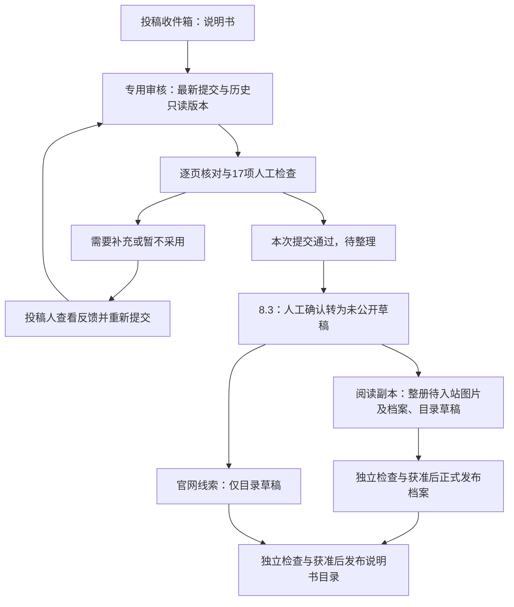

# 说明书8.1：线上投稿审核接入设计

设计日期：2026年11月15日。状态：8.1设计完成；8.2—8.5尚未执行。

本阶段将5.4已有的本机专用审核接到现有受保护的管理员工作台。接入后，管理员可以查看某次提交、逐页核对、要求补充或记录通过；再通过单独的操作生成未公开草稿。审核通过、生成草稿和公开发布是三个独立步骤。

本次交付仅为设计、改动清单与[验收清单](manuals-online-review-phase8-acceptance.md)。没有修改程序、安装依赖、复制真实投稿、建立业务备份、提交或推送Git、部署、重启服务或开放功能。PDF线上开放和首批真实资料入站仍分别安排。

## 一、依据和现状

### 已核实的基础

2026年11月15日19:49（北京时间）对服务器进行了只读核对：

| 项目 | 实际状态 | 对本阶段的含义 |
| --- | --- | --- |
| 管理入口 | 现有管理域名与管理员身份校验正常；服务监听127.0.0.1:4174 | 复用现有入口，不增加端口、域名、登录体系或管理员角色 |
| 程序版本 | 功能提交`6af8bc27f0e1e61345d4967ce6ea136c09a57809` | 以后续开发时复核的生产源码为基线 |
| main记录 | `1e84c27d7e95f51f5bfb335bc1f06d4a50769c6b`；服务器记为文档更新、无需构建 | 与功能版本不同，不能误报尚未部署 |
| 线上目录维护 | `manualsMaintenanceVersion=1`、`manualsDraftMaintenanceVersion=1` | 7.5已完成；该能力不包括投稿专用审核 |
| 专用审核与PDF交接 | `manualReviewVersion=0`、`manualPdfHandoffVersion=0` | 程序存在，但线上尚未开放 |
| PDF实际开关 | 管理、账号、匿名收件三个进程均为`LJM_ACCOUNT_PDF_OPEN=false` | 本阶段及后续8.2—8.5继续保持关闭 |
| 目录私密记录 | 501字节；正式部分与草稿均为0品牌、0型号、0文档 | 不能把当前空目录当成可以随意初始化或覆盖的授权 |
| 业务服务 | 管理、账号、匿名收件、点赞均active，自动发布定时器正常等待 | 本次没有改变它们 |

目录记录摘要仍为`db84ca6e267d1bacd52a8b528bb43c55e8943ddc3c7f9326ffc493bf773dd26a`。本次只读取程序、开关白名单、目录权限与数量等必要信息，没有查看投稿正文、图片、账号信息、密码或令牌。

本机候选源码位于Git忽略的`outputs/manuals-online-phase7-5/candidate/`。其HEAD与远程main相同；服务器的`server.mjs`、`submissions.mjs`、`manual-review.mjs`和`manual-review-catalog.mjs`四份核心程序，逐份与该提交的Git原始内容SHA-256一致。根工作区包含较早代码及其他未提交修改，后续不得整目录覆盖现网。候选中的运行时图片清单改动也不得带入提交。

相关规则及既有成果：[项目规则](../AGENTS.md)、[隐私检查](privacy-checklist.md)、[入站流程](intake-sop.md)、[5.4专用审核](manuals-phase5-4-review.md)、[7.1线上维护设计](manuals-online-maintenance-phase7-1-design.md)、[7.5完成清单](manuals-online-maintenance-phase7-5-checklist.md)、[PDF支持设计](manuals-pdf-support-design.md)。本次设计不替代上述人工确认与线上授权要求。

### 已有能力与需要改造的地方

| 现有代码事实 | 接入要求 | 实施阶段 |
| --- | --- | --- |
| 线上统一拦截专用页面、审核、转入和留存图片路由 | 按审核、转入、PDF分别校验，不能直接删除整段拦截 | 8.2、8.3 |
| `manualReviewVersion`在本机同时带出审核和非PDF转入界面 | 增加独立转入能力，界面和接口同时判断；旧客户端也不能越过限制 | 8.2 |
| GET审核详情同时读取目录维护状态 | 8.2审核读取与目录独立；目录不可用不能妨碍保存补充意见 | 8.2 |
| 表单有“本地工作台”“内部备注（仅本地）”等提示 | 按实际运行模式显示；线上改为管理员私密处理说明 | 8.2 |
| 有提交快照、17项检查、图片摘要及逐册文件锁 | 继续使用，并在转入与发布时复核检查内容，不能只相信`approved`文字 | 8.2、8.3 |
| 审核绑定尚无经过验证的线上操作者信息 | 保存服务端确认的管理员、时间及操作编号，客户端不能自报身份 | 8.2 |
| 现有操作回执、待核对状态与交接记录已能阻止盲目重复执行 | 补全说明书专用结果摘要、刷新后查结果入口，以及能够证明完成的核对流程 | 8.2、8.3 |
| 当前页面的待核对操作只在内存中 | 页面刷新或正常重新登录后，仍可找回操作编号；不在浏览器持久保存审核正文 | 8.2 |
| 交接包含图片、档案草稿、目录草稿和投稿记录的多步写入 | 保留现有交接检查点，补齐每步证据及失败后核对，不能假定一次文件改名能完成全册事务 | 8.3 |
| 目录发布使用字段白名单，剔除审核依据、内部备注与私密来源绑定 | 保留并扩充隐私回归；不把“仅本地”改名误解为允许公开这些字段 | 8.2—8.4 |

这些是后续开发要求，不是本轮已修复的程序功能。

## 二、范围及阶段拆分

| 编号 | 本阶段完成标准 | 本阶段结束时的边界 |
| --- | --- | --- |
| 8.1 接入设计 | 本文件、逐项验收清单、总计划与开发日志完成并自检 | 只改文档；本次到此停止 |
| 8.2 网页专用审核 | 入口、身份校验、非PDF版本与页图、17项审核、反馈、操作者审计、断线结果核对，在本地合成环境完成 | 整册转入接口和按钮仍关闭；不部署 |
| 8.3 未公开草稿衔接 | 两种提供方式、完整页序、目录关系、交接回执及故障核对、后续发布门禁完成 | 只生成草稿；不部署、不自动发布 |
| 8.4 全过程验收 | Windows与真实Linux、电脑与手机、200页、并发、中断、恢复、升级及隐私验收完成并修复问题 | 服务器隔离演练先准备具体范围，再按项目规则取得该次授权 |
| 8.5 上线与开放 | 正确生产基线、具体清单、按实际大小的必要备份与恢复证明；获批后部署并完成真实登录验收 | 线上写入与开放单独授权；PDF及真实资料发布不随之获准 |

8.2—8.5第一轮只支持`source_format`为图片（旧记录没有该字段时按既有图片记录核实）或无文件的官网线索。当前记录或所请求历史版本为PDF时，服务端明确阻止对应专用详情、页图、审核和交接；不能仅隐藏PDF按钮。旧PDF版本可显示“不在本次线上开放范围”及版本日期，不返回处理报告、源文件信息或页图。即使提供方式是官网线索，只要当前记录属于PDF，也不通过本轮通道处理。

如果缺少格式标记但仍含PDF快照或处理引用，且不能证明是普通图片版本，同样按不支持处理；不能删除或改写格式字段来绕过限制。管理详情返回所需字段白名单，不把整个原始投稿记录直接交给线上页面。

本机既有PDF及21项人工检查流程继续保留，线上PDF另依6.6后续清单处理。不新增全文识别、远程抓取、批量自动通过、用户管理角色、评论或支付。

## 三、使用流程和页面设计

### 入口与状态提示

1. 继续从“投稿审核”收件箱进入：`/admin/submissions.html`，选择说明书后打开`/admin/manual-review.html?id=TG-…`；“说明书维护”仍负责目录，不混用两个入口。
2. 开关关闭时，收件箱保留正确的当前状态摘要，显示“说明书专用审核暂未在线上开放”；直接访问页面给出可理解的受限提示与返回收件箱按钮，接口返回稳定错误码。
3. 页面上方显示题名、私密投稿编号、当前记录版、正在核对的提交版、提交时间、提供方式、状态和停止申请。提交版本与当前记录版本分开显示，避免同一册更新后看错。
4. 初始使用“管理员工作区 · 访问受限”的中性提示；服务端返回`online`后显示“管理员专用 · 受保护访问”，`local`显示本机说明；不要在加载失败时猜测模式。
5. 固定提供“返回投稿收件箱”“说明书目录维护”“档案管理”；有已生成草稿时增加准确链接。8.2转入区域显示“整册转草稿将在8.3接通”，不出现可提交按钮。

### 阅读与审核

- 电脑宽屏以阅读区和信息区并排为主；手机按信息、阅读、审核顺序纵向排列。先加载当前页，只按需要加载相邻页，不能一次并发请求200张图片。
- 保留上一页、下一页、页序跳转、纸面页码、适宽和原尺寸；第1页及末页按钮状态正确。无页图的官网线索显示“本次只提供官网线索，无站内阅读页图”，不显示图片损坏错误。
- 切换旧版后明确只读，不能保存审核或转入；切回最新版须重新勾选。本地未保存文字在当前页保留，重新读取会替换输入时先提示。
- 审核结论沿用“需要补充”“暂不采用”“本次提交通过，待整理”。补充和不采用必须填写给投稿人的原因；该反馈只对有权查看该投稿的用户及管理员可见，不是公开站说明。
- “内部备注”和型号、来源、权利依据标明“仅管理员，保存在私密区”。拟公开题名、介绍与目录字段在8.3单独填写，不从内部备注、投稿联系方式或投稿人原文自动拼接。
- 通过前人工完成4项说明书核对和13项隐私核对，共17项，记录完整型号适用范围、来源和提供范围的依据；没有一键全选、默认勾选或“浏览过就自动通过”。官网线索仍人工核对对应的来源与提供范围，不把没有附页伪装成逐页阅读完成。
- 图片失败、资料不完整、疑似敏感信息或可识别人物未完成判断时，提示停止通过并要求补充或交由档案所有人判断。工具检查和投稿人的勾选不能代替管理员判断。
- 采用现有站点样式；键盘可操作、焦点可见、状态使用文字说明，手机表单及图片不撑宽页面。

### 保存、会话到期与结果核对

- 点击保存后锁住本次重复提交，显示“正在保存审核结果”；取得持久回执后才显示成功。页面读取失败、HTML登录页被当成JSON、401/403、网断和超时分别给出可理解的提示。
- 未确认结果时保留当前页输入及操作编号，显示“核对上次操作”；不能把超时直接当作失败并创建新操作。
- 浏览器会话存储只暂存投稿编号、操作/步骤编号、动作和时间，用于同一管理站刷新或重新登录后找回结果；不存审核文字、内部依据、页图、邮箱或认证令牌。退出或明确结束核对后清除本轮标记，不做跨设备同步。
- 标签页关闭导致会话标记丢失时，重新打开该册仍从服务端读取这册最近的相关操作及未决记录，先核对再编辑；不能把浏览器是否还有标记当成“服务器没有执行”的证据。该摘要只返回获准管理员，按当前投稿编号筛选，不扫描或展示其他投稿正文。
- 先查询现有操作回执及投稿记录：已成功则读取最新结果；排队/运行中继续等候；待人工核对则禁止重复执行；明确未写入才允许按规则重新发起。刷新后若请求正文已丢失，必须重读、重新核对并重新填写，不能只凭编号重造原请求。
- 正常登录由用户在现有登录页面完成，不绕过Cloudflare校验。重新登录后仍先核对原操作，再继续编辑。

## 四、管理员权限与功能开关

### 权限沿用现状

线上所有页面、脚本、详情、历史页图、结果查询和写入接口继续在现有管理员身份校验之后提供；健康接口只暴露不含个人信息的能力与状态。沿用Cloudflare Access令牌的签名、签发方、适用站点、有效期及管理员邮箱白名单验证。普通网站账号、伪造邮箱请求头、缺失或过期令牌均不能成为管理员。

写入继续要求正确管理站`Origin`、`X-LJM-Admin-Request: 1`、JSON格式、操作编号和步骤编号；服务端限制请求体及字段白名单，不接收客户端提供的文件路径、操作者邮箱、发布时间或“跳过审核”参数。原有管理员具有同一管理权限，不新增多人分工或审批角色。

审核、交接及核对记录中的操作者取自服务端验证身份，本机使用明确的本机维护者标记。审计信息留在私密记录；操作请求指纹包含服务端身份绑定，防止同一编号换内容或换身份重放写入。已获准管理员可以查看必要的私密结果摘要；身份变化后需重新读取资料，不能沿用另一个人的未确认输入继续写。

### 接口边界

下表保留既有路径，仅最后一项为8.3拟新增的核对动作；实施时同步校验路由格式，不增加任意文件读取或修改接口。

| 接口 | 返回/操作 | 必须满足的边界 |
| --- | --- | --- |
| `GET /api/admin/submissions` | 既有收件箱摘要及能力 | 不返回内部备注、完整版本或私密页图内容 |
| `GET /api/admin/submissions/{id}` | 普通投稿详情；说明书仅用于收件箱摘要 | 线上说明书不借此返回完整原始记录或绕开专用PDF限制；普通投稿行为保持 |
| `GET /api/admin/manual-submissions/{id}` | 所需审核字段、非PDF版本、17项规则、模式/能力及该册最近操作摘要 | 需审核能力；不读目录以完成8.2审核；8.3仅在目录可用时附交接所需版本及准备状态 |
| `GET /api/admin/manual-submissions/{id}/versions/{revision}/images/{filename}` | 已列入该版本的私密JPEG | 同一投稿/版本绑定，摘要、格式、路径与非PDF检查全部通过 |
| `POST /api/admin/manual-submissions/{id}/review` | 保存当前提交审核 | 审核开关、可信来源、身份、版本、动作及证据校验；不生成草稿 |
| `POST /api/admin/manual-submissions/{id}/transfer` | 8.3独立交接 | 审核及转入能力、目录准备状态和有效绑定均通过；8.2后端仍拒绝 |
| `GET /api/operations/{operationId}`、`POST /api/cancel-operation` | 既有私密回执查询及取消请求 | 查询仍需管理员；取消需可信写入请求，只停止后续步骤，不承诺回滚已有结果 |
| 拟`POST /api/admin/manual-submissions/{id}/resolve-operation` | 8.3核对可证明的原操作结果 | 只接收操作/步骤编号等受控定位字段，由服务器核对实际结果；不得提交路径、任意状态或“忽略冲突”参数 |

说明书详情中的可见版本、最近操作和当前能力都是服务端计算的响应，不接受客户端覆盖。封闭功能通常返回404与稳定的受限原因，版本冲突/待核对返回409，缺少必要协议字段返回428，格式/体积错误沿用现有状态约定；身份校验沿用现有401/403等行为。失败响应避免回显私密原文。页面成功提示以可核验的持久回执为准。

### 新增开关设计（尚未安装）

复用既有私密配置`/etc/laojiumopian-manuals.conf`及服务配置读取链；本轮仅确定名称和语义，8.2—8.5再实现、核验和安装。

| 设置/能力 | 含义 | 默认及约束 |
| --- | --- | --- |
| 已有`LJM_MANUALS_ONLINE_ENABLED` | 目录维护、草稿及正式发布能力 | 本次现网为true；不因此开放审核 |
| 拟新增`LJM_MANUAL_REVIEW_ONLINE_ENABLED` | 非PDF专用阅读与保存审核结果 | 默认false；只接受严格的true/false |
| 拟新增`LJM_MANUAL_TRANSFER_ONLINE_ENABLED` | 已审核非PDF投稿转未公开草稿 | 默认false；有效能力还需审核开启、目录可维护、私密状态正常、Linux锁及写入能力可用 |
| 已有`manualReviewVersion` | 当前能否使用专用审核 | 本机保留1；线上按审核设置及运行准备状态计算 |
| 拟新增`manualTransferVersion` | 当前能否使用非PDF交接 | 独立于审核；旧页面不能凭审核版本1直接转入 |
| 已有`manualPdfHandoffVersion`及PDF相关能力 | PDF处理与交接 | 本轮线上始终为0；本机原有行为不变 |

线上审核保存不能依赖目录维护开启或目录空库初始化。目录关闭时可保存补充、暂不采用及有效的通过结论，但转入必须拒绝。转入设置为true而其他条件不满足时，能力返回0并给出具体原因，不能自行补开依赖功能。非法布尔值在启动检查中报错，不能猜测为开启。

| 场景 | 查看及保存非PDF审核 | 转非PDF草稿 | PDF线上审核/交接 |
| --- | --- | --- | --- |
| 当前现网/新版本默认 | 关闭 | 关闭 | 关闭 |
| 仅审核开关开启 | 允许，受状态和身份限制 | 关闭 | 关闭 |
| 审核、转入、目录维护均开启且准备状态通过 | 允许 | 允许，逐册人工确认 | 关闭 |
| 目录关闭但审核开启 | 允许 | 关闭 | 关闭 |
| 投稿停止、版本不符或交接待核对 | 私密查看；阻止不合法保存 | 关闭 | 关闭 |
| 身份不通过 | 全部拒绝 | 全部拒绝 | 全部拒绝 |

开关和能力同时在后端执行，页面只负责如实显示。大小写、编码路径、直接API请求、旧脚本及普通投稿审核/转入接口均不能旁路。紧急停用由维护者按获准操作把转入与审核设为false并重启管理服务；保留私密资料和已有回执。该操作不自动撤下已公开档案，也不关闭已有图片投稿或目录维护。

## 五、资料保存与公开边界

继续使用文件记录、现有私密收件区、账号归属和写入协调器，不建立新数据库、后台服务、云存储或第三方依赖。Node使用现有内置能力；邮件复用已有通知队列及服务，不新增服务商。

| 内容 | 现有/拟使用位置 | 边界 |
| --- | --- | --- |
| 投稿记录、只读提交、同意范围、审核结论、内部备注 | `/srv/laojiumopian-admin/data/submissions/TG-…/record.json` | 服务端原子保存；账号端只返回有权查看的字段 |
| 投稿私密图片 | 同一投稿目录下的`manual-<摘要>.jpg` | 只按已记录版本、页身份和摘要读取，不接受任意路径 |
| 审核操作者及交接检查点 | 同一私密记录的审核绑定、history、`manual_handoff`扩展 | 新字段兼容旧记录；不能写进档案公开元数据 |
| 写入排队、回执、待核对状态 | 既有`data/operations/` | 仅存必要摘要；不复制整本图片或内部说明 |
| 阅读副本的档案草稿与来源映射 | 既有`data/drafts/` | 未公开，保留提交版、摘要及逐页映射 |
| 经人工确认的待入站图片 | 线上既有`data/inbox/LJM-…/`，本机仍为`public-assets/inbox/` | 不直接写到站点公开图片目录；不复制主档 |
| 目录草稿、正式私密记录、历史与发布事务 | 既有`data/manuals/` | 延续7.5初始化、草稿保留、历史与发布恢复规则 |
| 正式目录公开输入 | 现用应用的`site/src/data/generated/manuals-catalog.json` | 只有独立正式发布生成的白名单投影能进入 |
| 公开网页及发布副本 | 既有不可变网页版本与正式档案发布层 | 审核和交接均不能写入或切换公开版本 |

现网`submissions`、`manuals`、`operations`目录为0700，`drafts`和`inbox`为0750，均由既有业务用户持有。新审核私密文件使用0600、其专用私密子目录使用0700，并核对所属用户与组；不对整棵既有数据目录递归改权限，不扩展账号/匿名收件服务对档案、目录或操作记录的写权限。管理服务已获准的数据目录足以保存本阶段成果，不增加系统可写范围。

页图接口必须同时校验合法投稿编号、该投稿的提交版、版本内文件清单、完整文件摘要、JPEG真实格式及大小；对目录层级和文件拒绝链接与越界路径。不能借历史版本读到另一册图片；原PDF、RAW、TIFF、报告、信任文件和任意服务器路径没有新增下载接口。返回`no-store`、`noindex`、同源资源限制与现有安全响应头。

提供官网网址只记录经现有安全规则验证的HTTPS链接，管理员人工核对来源名称、可用情况与日期；不自动下载网址、跟随重定向抓取内网或远程转换文件。外部打开使用现有安全链接属性，避免携带管理页来源信息。

`private_note`、三类审核依据、操作者、账号归属、投稿编号、历史、快照、文件摘要和交接字段均不进入公开JSON、搜索索引、HTML、站点地图、构建包或公开错误。目录中的`evidence`、`applicability_basis`、`display_basis`继续仅供私密发布检查，沿用`manualPublicationInput()`字段白名单剔除，不能直接序列化整个目录状态。公开题名、介绍、缺页说明、目录页码及官网信息仍须人工核对，公开预览只使用最终白名单字段。

沿用当前最近20次提交版本规则、已有图片和账号容量规则；不为接入线上修改保留期限、删除历史或自动清理上传文件。停止、退稿与注销申请不等于允许立即删除资料；不可逆清理另按原规则逐次授权。

## 六、审核与提交版本绑定

审核输入沿用`revision`（当前记录版）、`submitted_revision`（本次提交版）、`snapshot_digest`（提交内容摘要）；审核结论、反馈、内部备注、三类依据、4项说明书和13项隐私确认严格校验。没有提交快照、摘要无法重算、图片缺失/改变、旧版本、字段不全、人物风险未确定或停止申请已收到时，不得保存“通过”。

通过结论绑定本次提交、提供范围及每页内容，保存服务端时间、操作者、操作/步骤编号和检查规则版本。`approved`只能显示“本次提交通过，待整理”，不能替换档案的公开状态或目录发布确认。

| 变化 | 处理要求 |
| --- | --- |
| 投稿人开始补充、撤回修改或重新提交 | 旧表单不能写入新版本；清除旧确认，保留历史供只读核对 |
| 页序、纸面页码、页图、型号、来源或同意范围变化 | 重新计算快照并重新审核；旧勾选不能沿用 |
| 收到停止处理申请 | 新审核通过、交接及后续公开动作全部阻止；显示已受理状态 |
| 已进入交接或已有关联草稿 | 审核绑定只读，防止更改原依据后覆盖已有结果 |
| 另一管理员已保存 | 返回版本冲突，保留当前输入供人工对照；重读后重新确认 |
| 旧版绑定缺少当前必需证据或损坏 | 显示待重新核对；不批量补签、不自动认定通过；已有关联结果时走人工核对 |

17项有效性和三类依据不仅在保存时检查，8.3的交接及后续档案/目录发布也要复核。对旧记录读取兼容，对不足以证明的旧审核不放宽条件；不能因缺少记录重建一个“空的已通过状态”。

给投稿人的反馈与管理内部备注分别保存；账号端响应、历史及通知不带内部依据、操作者邮箱或交接内部故障。审核结果保存是主要事务，通知发送复用既有队列；通知失败保留待处理状态，不撤回已保存结果，也不通过重复审核重复发信。本轮不发送真实测试邮件。

## 七、8.3交接设计

### 阅读副本

1. 再核对审核绑定、当前投稿和目录版本、17项证据、停止状态、全册摘要及存储余量。先计算品牌、型号和文档冲突，任何不一致在分配编号和复制图片前停止。
2. 管理员填写整理后的题名、公开介绍、物件名称、地区/版本，明确选择已有`RPR`或`OTH`正式类型及实际接收/获得日期，逐册确认。本日期不是说明书印刷年代；不新增类型代码，不推算日期。
3. 复用现有编号分配和`submissionToDraft()`，按已审核完整页序写入待入站区，不裁剪成部分页，也不重新压缩替换已审核的JPEG。保存页身份、纸面页码、摘要和档案路径的一一映射。现有每册最多200页/100 MB边界保持不变。
4. 生成`core`、`metadata`、`public_view`结构的未公开档案草稿；初始保持`SUS / Y / U0`和权利未知`UNK`，不因审核通过直接改为公开合格。读取现有正式代码字典和类型schema，不自建另一套元数据。
5. 生成品牌、完整型号与文档目录草稿。只匹配规范化后确切品牌和完整型号；别名、同名、品类或产品名称冲突、相同版本疑似重复时停止，由管理员在目录维护中核对，不模糊合并。
6. 回执确认档案、完整页序和目录草稿均已保存后，才标记交接完成并显示继续维护的链接。稳定的`manual-…`目录标识与私密`TG-…`投稿编号分开。

### 官网线索

同样校验审核和目录版本，但只生成目录草稿。填写官网来源名称、HTTPS网址、人工核对日期、可用状态及私密核对依据；不自动抓取网页或文件，不复制附件图片，不生成实物档案或永久编号，不扩大成站内阅读授权。即便投稿曾附截图，也只保留于私密审核区。

### 正式发布

交接结果仍是草稿。阅读副本先在档案管理完成字段、类型/schema、隐私、图片路径及用户发布确认，正式构建通过后才能成为已发布档案；目录再独立检查并发布。官网线索只走目录发布，但仍需确认其公开文字与来源。

保留7.5的正式发布审查、共享部署锁、原子切换和回退。目录不能引用未公开、撤下、停止处理或绑定失效的稿件；普通档案发布、批量发布、历史恢复后重新发布、目录发布/恢复和Git自动部署都要覆盖同一来源门禁，不能删掉来源绑定后绕过检查。既有公开资料收到停止申请时，先阻止后续发布，是否及如何撤下另按具体资料处理，不伪称已自动下架。

## 八、并发、回执和故障处理

### 锁与写入顺序

沿用既有Linux部署锁、管理端写入队列及投稿逐册文件锁，固定顺序为“部署锁 → 管理写入队列 → 投稿锁”。管理审核开启但目录维护关闭时，也不能因为原先只按目录维护开关判断而跳过必要部署锁。只读页图及状态查询不等待长构建；保存操作排队后显示状态。

账号、匿名收件和管理端共同读写同一个投稿根，涉及投稿变化的操作使用同一逐册锁。停止申请只有真实写入后才显示已受理；遇忙碌冲突必须明确“尚未受理，请核对后重试”，不能显示成功。不要删除仍在运行进程持有的锁目录。

长时间的整册构建应在切换前重新核对投稿状态；8.3需把非PDF说明书也纳入构建前、构建后及切站前复核，避免整个构建期间阻塞停止申请。最终复核到切换的短临界区与投稿写入互斥，防止已受理停止后仍公开。若先后顺序无法证明，保留当前公开版本并转入待核对。

### 回执与交接检查点

使用现有`operationId / stepId`及请求指纹，继续禁止同一编号换内容。现有通用回执缺少官网线索的目录结果，8.2—8.3要增加受白名单校验的说明书结果摘要：投稿编号、动作、提交版/摘要、保存后记录版、结论；交接另含目录标识、可选档案编号及完整页数。摘要不包含审核正文、身份令牌、源文件或图片数据；不再借用译文版本字段表示说明书审核版。

`manual_handoff`继续保存`in-progress / complete / needs_review`检查点，并补齐操作者、操作/步骤编号、交接前目录版本、结果版本、档案编号、完整页图清单摘要和目录标识。每个重要结果写完即留下可核对证据。应先保存足以定位新编号和待入站目标的记录，再执行可能中断的多文件复制，避免出现无法关联的半册目录。

| 情况 | 处理方式 |
| --- | --- |
| 校验失败，确定未写入 | 返回明确原因；重读或修正后可发起新操作 |
| 同一操作重复到达 | 查询原回执，不再次分配编号、复制图片或追加目录 |
| 已全部写入，仅响应丢失 | 通过回执和绑定一致的私密结果确认成功，不重新执行 |
| 图片复制、草稿保存或目录保存部分完成 | 保留全部已写入结果和编号，标为待核对，冻结相关写入；不能自动删除半成品或重用编号 |
| 程序重启留下运行中操作 | 沿用现有协调器转为待核对；不能仅重启就清空记录解锁 |
| 回执丢失但结果可能存在 | 逐一核对投稿检查点、编号、草稿来源、全部图片摘要、目录私密绑定；证据齐全才确认完成 |
| 结果或版本冲突、损坏、无法证明 | 维持只读和冻结，输出安全的定位信息；由维护者按清单恢复，不覆盖后续有效修改 |
| 用户取消 | 复制或写入开始前可安全结束；已有写入则停止下一步并核对，不能提示“全部撤销” |

待核对状态保留现有写入协调器的保守阻断，不为恢复工作绕过全局保护。8.3提供受保护的“核对交接结果”流程，复用现有文件、回执及证明机制；只确认可证明的完成或确定未发生的操作，不提供任意文件编辑/删除入口。需要补完或回退实际业务数据时，先生成明确清单并遵守对应操作授权。回执格式、私密扩展字段及旧版本程序的读取/回退兼容性在8.4明确验证；不证明兼容就不允许回退后自动恢复写入。

### 磁盘与容量

只读核对时系统盘可用8662 MiB、使用率78%，这只是当时状态，不是后续空间保证。8.3交接前重新计算整册图片、草稿/清单、现有目录历史及必要临时空间；复用既有容量限制和安全余量。空间不足在复制前停止，写入期间磁盘满也必须保留可核对结果。

一册交接只复制获准的整册发布候选，不因保存一次审核或草稿复制全站图片、数据库或旧网站版本。已有提交快照仍在收件区引用原私密图片，不为每次审核再复制一套图片。

## 九、后续具体改动清单

下列路径均相对于项目，指正确生产基线上的文件；本轮不改这些程序。

| 文件/区域 | 8.2工作 | 8.3及8.4工作 |
| --- | --- | --- |
| `local-admin/server.mjs` | 独立开关与能力、受保护页面/API、审核与目录解耦、PDF逐路由阻断、服务端身份绑定、私密响应白名单 | 独立转入能力、部署锁准备检查、结果核对、公共发布入口一致拦截 |
| `local-admin/public/submissions.js`、`manual-review.html/js/css` | 收件箱入口、真实模式提示、版本/页图/17项表单、反馈与只读状态、会话到期、刷新后核对、手机布局 | 两种交接表单、依赖原因、待核对与草稿链接 |
| `shared/manual-review.mjs`、`local-admin/manual-review.mjs` | 字段校验、操作者与检查规则版本、图片/路径防护、旧审核证据不足时拒绝通过 | 严格复核审核绑定、提前记录编号和结果、完整交接证明、停止处理竞态 |
| `local-admin/submissions.mjs`、`manual-workflow.mjs` | 管理/账号响应边界，保持既有补充和撤回语义 | 交接与停止共用锁，非PDF说明书构建期间及切站前再检查 |
| `local-admin/manual-review-catalog.mjs`、`manuals.mjs` | 审核本身不依赖目录初始化 | 稳定目录标识、精确匹配、保护旧草稿及私密来源、保持公开投影白名单 |
| `local-admin/write-coordinator.mjs`及调用处 | 说明书回执、身份指纹绑定、旧记录兼容；保持其他业务回执语义 | 可证明的交接结果核对、重启恢复，冻结及取消边界 |
| `deployment/manuals.env.example`、现有部署配置检查 | 增加两个默认关闭的说明书开关示例，验证配置读取一致 | 打包、同步、恢复、保留与升级保护，不复制私密状态到程序包 |
| 现有`local-admin/tests/`及`site/scripts/`检查 | 权限、开关、版本、反馈、图片、PDF关闭、客户端恢复的行为测试 | 200页/两类提供方式、并发、注入中断、实际Linux锁、公开成品及升级恢复 |

开发先在最新main/生产基线建立独立`codex/`分支或候选副本，保留根工作区和运行时投影。按阶段仅提交相应差异；不安装新包。必要程序变更后执行相关行为检查及项目已有正式构建；条件跳过与实际执行分开报告，不能把静态检查当Linux或浏览器实测。

## 十、8.4验收及8.5上线门禁

详细案例见[阶段八验收清单](manuals-online-review-phase8-acceptance.md)。至少覆盖身份和直接API越权、独立开关、两类非PDF、旧版只读、17项人工检查、补充/撤回、200页、图片损坏、断线刷新、双人冲突、停止与构建竞态、逐步中断、重启、磁盘满、链接/越界路径、PDF关闭、私密字段排除、既有目录维护及账号投稿回归。

8.4先完成本地和可审阅的合成材料，再准备真实Linux独立目录、低权限进程、资源/空间上限、传输大小及清理对象清单，取得该次服务器演练授权后执行。只用合成说明书，不使用真实隐私资料，不发送真实通知，不将合成册公开。

8.5上线前必须重新读取现网版本、能力、相关私密状态与未决操作，不能沿用本文件的空目录或磁盘余量。备份按实际差异确定：相关配置、投稿记录/审核与交接证据、受影响的档案/目录草稿、待入站新增图片及恢复所需文件；保留可回退的程序和公开版本。已有不可变、已核验备份可复用，但文件摘要不能替代尚无副本的真实数据。

先列出每类文件数量、实际字节、恢复副本和临时空间，再给出操作总预算；本方案不承诺把200页真实图片备份压在7.5的2 MiB范围。没有数据变化的代码更新不重复打全站和账号数据库大包；真实差量缺失时必须补足必要备份。恢复在独立私密目录验证文件内容、权限、所有者、来源绑定与应用可读性，不覆盖真实业务，也不自动永久清理旧资料。

正式上线按“默认关闭部署 → 检查旧业务及私密状态保留 → 获批范围内开启非PDF审核/转入 → 正常管理员登录验收”执行。服务重启、自动部署定时器协调、业务暂停、回退条件及实际验收对象均在具体授权清单中写明；不得用本阶段设计代替授权。现有原站、图片投稿与目录维护不能因新功能被无故停用。PDF仍关闭；真实投稿是否转入和公开，另按逐册隐私、权利和发布确认处理。

## 十一、8.1交付核对

- 已核对总计划、项目规则、5.4/6.6/7.5边界、程序实现及现网只读状态，并逐份核对四个核心文件与Git基线内容。
- 已确定入口、页面、独立能力与开关、身份、私密存储、版本绑定、两类交接、回执/中断核对、停止处理、容量及上线/备份边界。
- 已形成可逐项执行的验收清单，明确哪些属于设计检查、哪些仍待程序开发和真实环境验收；总计划与开发日志同步更新。
- 本轮只对文档做一致性、链接、编码及修改范围检查；保护档案和待入站源文件、原日志前缀与现有程序。没有运行功能测试或构建，不把历史测试数字计作8.1的新验收。

8.1完成后停止。下一项为8.2“网页专用审核”，收到用户该阶段指令后再开始开发。
