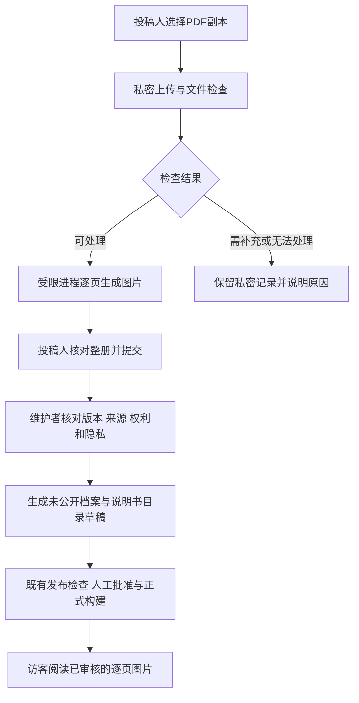
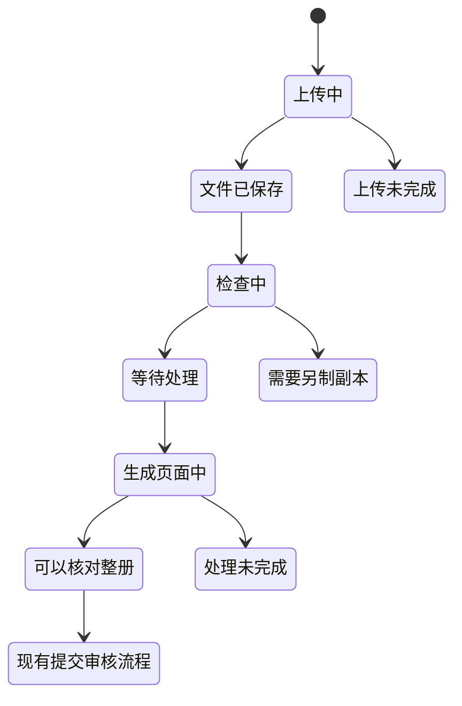

# 说明书PDF支持方案设计

设计日期：2026年11月11日  
所属阶段：阶段六「按需求增强」中的PDF支持。  
当前状态：设计完成；6.1工具与Windows隔离、6.2私密上传、6.3整册生成与预览已在本地完成。6.4送审与版本审核已完成本地功能、自动检查和浏览器操作／外观验收，见[6.4检查记录](manuals-pdf-phase6-4-review.md)。6.5整理发布衔接与全过程验收已完成，见[6.5记录](manuals-pdf-phase6-5-review.md)。真实资料入站及线上部署尚未实施。

## 一 首版怎样使用

推荐首版采用「私密接收PDF → 生成逐页图片 → 投稿人核对 → 人工审核 → 沿用现有阅读与发布流程」。用户可以提交一本PDF说明书，访客阅读经过核对的页面图片。提交的PDF文件始终保留在私密投稿区，公开网站不提供该文件。

这能复用现有200页长册能力、逐页阅读器和5.4审核门禁，公开端也能按需加载页面。代价是首版没有PDF文字选择、文件内超链接、原PDF书签和全文搜索；页面图片放大后不能始终保持矢量文字的清晰度。整本PDF下载另行设计，不用隐藏下载按钮充当文件保护。

本设计用于逐阶段下任务。6.1—6.5已完成本地开发与对应合成验收；6.6仍按后续明确指令实施，不因本地送审和审核功能存在而自动发布或上线。

### 首版范围

| 能力 | 设计决定 |
| --- | --- |
| PDF投稿 | 登录后，在说明书私密草稿中选择一份已经筛选的PDF副本 |
| 本册预览 | 文件检查及转换完成后，按页预览实际生成的阅读副本 |
| 提交审核 | 必须先核对整册，沿用原编号、归属、进度、补充和只读提交版本 |
| 访客阅读 | 沿用现有翻页、跳页、放大、目录、缺页提示与返回查询条件 |
| 官方资料 | 仅有官网线索时继续登记链接；不自动抓取远程PDF或推定转载许可 |
| 维护与发布 | 仍由本机工作台人工核对，再经过待入站区、未公开档案及目录草稿、正式发布检查 |
| 补充方式 | PDF模式先支持整份替换；可改纸面页码与缺页说明，不在首版混加图片、删页、重排或拼接多份PDF |
| 后续事项 | 原PDF公开、整本下载、OCR文字识别、全文索引、书签导入、批量采集、PDF合并均另行实施 |

第一轮开发仍只在本地完成。后续若在服务器开放PDF投稿，处理模块由既有账号服务调用，不部署本机管理页面、不新建云端后台。线上处理权限、资源隔离和工具安装须单独形成可审阅的上线清单；通过以前，线上PDF能力开关保持关闭。

## 二 与现有功能怎样衔接

当前图片版支持每张5 MiB、每册200页、累计图片100 MiB、账号私密图片200 MiB，保留最近20次提交版本；5.4已经完成具体版本审核、整册转入未公开草稿和官方来源草稿。PDF是新增的来稿方式，不新增档案对象类型、分类代码或另一套公开数据。

6.2已增加私密的 `source_format: images | pdf`，区分文件方式；“仅官网线索”继续由既有 `manual_metadata.sharing_scope` 表达，不重复增加第三套代码。旧记录没有该字段时兼容为图片方式，不批量改写旧数据。PDF最终转为既有页面结构，再进入原来的审核与发布流程；6.2仅保存文件。

6.2前代码核对发现，原账号容量统计主要识别私密JPEG文件。6.2已统一纳入PDF、历史源文件、未完成字节与操作预留，并覆盖既有图片入口；6.3已接入生成任务的输出预留、逐页预算和保留副本计量，见对应验收。不能仅复用现有200 MiB数字就宣称转换过程已经受限。



生成图片只是文件处理，不代表内容通过人工审核。工具提示「未发现某类对象」也不代表PDF绝对安全或已取得公开权利。

## 三 投稿人的页面与操作

入口仍是「说明书 → 提供说明书 → 登录 → 新建或继续草稿」，不另设一套投稿系统。

### 1 选择提供方式

先选择「官网线索」或「站内阅读副本」。官网线索只填写来源网址；站内阅读副本再选择「上传图片」或「上传PDF」。两种文件方式使用相同的品牌、完整型号、用途、语言、地区、版本、完整程度和来源字段。

材料区为空时允许切换图片与PDF；已有文件时不直接切换，提示继续当前方式，或另建草稿。旧图片不会为了切换方式被自动移除。

### 2 上传PDF

界面拟展示以下顺序：

```text
资料方式       上传图片  /  上传PDF
选择文件       [选择一份PDF]
文件信息       使用投稿人可辨认的文件名、大小；页数在检查后显示
剩余容量       本次文件占用、账号剩余空间、生成图片另需的空间
本人确认       所选文件是经过筛选的副本，主档已另行保存
操作           [上传到私密草稿]  [返回]
```

上传前只做文件名、大小和浏览器可读取性提示；真正的文件检查由接收端和处理工具完成。不能把浏览器给出的文件类型或页数当作可信结论。文件名只在私密界面显示，按纯文本处理。

上传进度与生成预览进度分开：先显示「正在上传文件」，完整接收后显示「文件已保存，正在检查」或「正在生成第X／Y页预览」。只有整册转换成功并原子保存页面清单后，显示「可以核对整册」。

### 3 整册核对与送审

- 使用现有单页阅读区和缩略页码列表，按需加载；不一次把200页都放进页面。
- PDF文件的第几页与纸面印刷页码分开显示，例如「文件第5页／共32页；印刷页码：3」。默认不猜测封面、目录和正文页码的对应关系。
- 投稿人可以填写纸面页码和缺页说明；PDF模式的页序固定为源文件顺序，不能调用图片接口偷偷删页或换页。
- 提交前确认实际生成的页面完整、方向和文字可读，并重新确认现有副本、提供范围、隐私与处理声明。文件处理未完成时，保留文字草稿，但不能提交阅读副本审核。
- 投稿人可以在断开后重新查看任务状态。关闭浏览器不表示已取消服务器上的处理，也不表示已经提交审核。

### 4 补充与停止

需要补充时，仍从「我的 → 我的投稿 → 查看投稿进度」进入同一编号。PDF首版要求补齐后的整份PDF重新上传，旧PDF和旧提交版本私密保留。新文件、新处理配置或新生成页面都会使旧审核失效。

替换前显示额外容量；容量不足时停止并说明原因，不自动删除旧版。尚未转入整理的记录沿用既有撤回和停止草稿规则；已转入整理的记录使用「申请停止处理」，继续阻止后续发布。

## 四 访客阅读与维护界面

### 访客看到的内容

详情页拟增加简短说明「由PDF制作的阅读副本」，继续显示品牌、适用型号、语言、版本、完整程度、公开来源及核对日期。阅读器使用既有页序、纸面页码、目录和图片，不额外嵌入原PDF。

翻页、跳页、放大和手机操作与图片版保持一致，页码网址仍使用既有规则。文件内部目录、外部超链接、附件和脚本不变成可点击内容；需要的目录由维护者人工录入。原PDF没有公开下载入口。

原PDF中的可选文字和辅助阅读结构不会随栅格图片保留。首版用明确页码、键盘可操作控件和人工核对的简介帮助使用，不能宣称具备完整的PDF无障碍阅读能力。后续如需文字层，必须另做公开文字核对和隐私检查。

### 维护者看到的内容

沿用「投稿审核 → 说明书投稿 → 打开说明书专用审核」，增加三个区域：

| 区域 | 显示与操作 |
| --- | --- |
| 文件处理 | 页数、检查时间、处理工具版本、是否加密、表单／脚本／附件提示、任务结果；私密文件名和详细报告仅供维护者查看 |
| 页面核对 | 具体提交版的逐页图片、源PDF页序、纸面页码；提示旋转、异常尺寸、明显裁切范围差异与缺字问题 |
| PDF补充检查 | 源文件与提交版一致；整册页面数量、顺序与可见范围一致；字体、图表和批注外观已核对；公开候选只有审核后的图片 |

上述4项PDF检查追加到现有4项说明书检查和13项隐私检查，合计21项，均需人工逐项确认。三个审核依据继续填写；没有全选捷径。PDF处理记录不能代替型号、来源、权利与真实人物隐私判断。

通过后仍先生成未公开档案和目录草稿。档案类型只选既有RPR／OTH及common结构，真实接收日期由人填写，初始仍为SUS／Y／U0、权利UNK。通过正式门禁后才能公开；官网线索不会因为附有PDF而自动升级为站内全文。

## 五 文件检查与处理规则

### 检查顺序

1. 核对登录、账号归属、可编辑版本、上传开关和操作凭证，先决定是否接收文件。
2. 为声明的字节数预留容量，将二进制流写入私密临时文件；实际字节超限立即停止，不能先把整份PDF读进内存。
3. 完整接收后计算SHA-256摘要，核对声明长度、文件头及操作指纹，保存为服务器生成的文件名。扩展名、MIME类型和文件头只是初筛，不能证明内容安全。
4. 在受限处理进程中读取页数、加密、表单、脚本、附件和页面尺寸等信息。解析异常或必要检查能力缺失时不继续转换。
5. 按下表处理；允许继续的文件按源页序逐页转换，生成结果仍只放在私密区。
6. 逐页重新解码并规范输出为JPEG，核对全部页数、摘要、尺寸和容量，再一次性提交新的页面清单。完成前不替换原有可读版本。

文件名、文件类型、大小、权限和存放位置分层检查的原则参考[OWASP文件上传指南](https://cheatsheetseries.owasp.org/cheatsheets/File_Upload_Cheat_Sheet.html)。本项目不将私密PDF发送给第三方在线转换或检测服务。

### 不同PDF的处理

| 情况 | 首版行为 |
| --- | --- |
| 普通非加密、无表单／脚本／嵌入附件的PDF | 进入受限转换，再由投稿人和维护者核对页面 |
| 打开密码、所有者加密或复制打印限制 | 不接收密码、不尝试破解或绕过；提示提供有权制作的普通阅读副本，或只登记官网入口 |
| 文件损坏、页数不明、0页或超过200页 | 保留失败原因；不能当作完整说明书送审，不偷偷截取前200页 |
| JavaScript、嵌入附件、作品集或交互表单 | 暂停自动处理，要求提供普通静态副本；不提取、不运行附件，也不把「未检测出」写成安全保证 |
| 数字签名、填写过的表单或动态外观 | 不承诺保留签名效力或表单逻辑；按不支持的交互文件处理，不自动扁平化替换原文件 |
| 可见手写字、签名、批注或个人信息 | 生成页面中可能仍可见，必须人工核对；需要脱敏时由资料所有人另制副本后重新提交 |
| 作者、电脑用户名、XMP属性、隐藏文字或历史修改 | 留在私密源文件；不抽取进公开字段，不复制源文件字节到公开目录 |
| 字体缺失、乱码、异常空白、细线不清或颜色明显变化 | 暂停该版送审，换合适的处理配置重新生成，或要求另制副本；不能降质后静默通过 |
| 横版、旋转页、跨页电路图 | 保留源旋转和长宽比例；不自动裁成竖版，不自动拆页 |

仅搜索PDF字节中的关键词不足以发现压缩对象或隐藏内容，不作为检查实现。检查报告只记录类别、是否发现及处理结果；不把完整私密元数据、批注正文、脚本和附件名称写进通用日志。

### 图片制作

建议起始配置为长边2400像素、JPEG质量90、sRGB，每次处理一页，单页最多5 MiB。2400像素是试验起点，不是清晰度承诺；6.1应对照小字号和电路图确定是否需要最高4096像素的配置，并始终限制单页不超过800万像素。

尊重PDF正常阅读时的CropBox可见范围，保留旋转和比例；发现与MediaBox差异明显时记录私密提示并人工核对。默认不隐藏可见批注，不自动去水印、锐化、二值化或改写文字。图片重新编码时不携带源PDF属性、文字层和附件。

生成图片不等于完成脱敏。页面上看得见的号码、签名和人物仍按既有隐私规则停止自动入站。脱敏只在另行准备的发布副本上进行，修改后重新生成或替换为明确核对的新版，不触碰唯一主档。

## 六 容量与运行限制

以下为建议初值，6.1以合成文件验证，6.2起统一由服务器下发。界面、接收端、容量统计和工具适配器必须使用同一份配置。

| 项目 | 建议限制 | 计量和超限行为 |
| --- | --- | --- |
| 单份PDF | 20 MiB | 按实际二进制字节，20 × 1024 × 1024；不是Base64后的大小 |
| 每册页数 | 200页 | 来自处理端核验，不信任前端声明；超限整份停止 |
| 当前源文件 | 每册1份 | 历史源文件私密保留；同册最多5份不同摘要的PDF副本，达到上限先人工处理 |
| 累计逐页图片 | 每册100 MiB | 沿用现有图片预算，含替换后保留的旧图片及失败任务已保留图片 |
| 私密图片份数 | 每册累计1000份 | 沿用现有留存上限，当前200页与历史、未引用结果一起统计；重试不能生成无限个小文件 |
| 账号私密资料 | 合计200 MiB | JPEG、PDF、历史、回收、未引用留存、临时文件和正在写入的预留合并计量 |
| 同时上传 | 每账号1份，服务合计2份 | 与图片上传共用容量锁和并发准入，不另开一条绕过限制的通道 |
| 转换并发 | 同一环境1册，排队最多10册；每账号最多1册运行或排队 | 使用私密任务文件和既有协调器，不引入任务数据库或队列服务 |
| 单页输出 | 长边最高4096像素、800万像素、5 MiB | 异常尺寸先拒绝；超限停止本版，不自动丢页 |
| 处理时限 | 文件信息10秒、单页30秒、整册20分钟 | 建议预算，命中则终止任务并保留失败结果；不承诺任意200页都能在预算内完成 |
| 处理内存 | 每个解析／转换进程硬限512 MiB | 必须由目标操作系统验证；Node的内存参数不能冒充外部工具的硬限 |
| 暂存空间 | 单任务含临时结果最高256 MiB | 启动前检查实际可用磁盘及全局预算；不足时保留草稿并停止处理 |

源PDF与图片占用分开计算。例如10 MiB的PDF生成60 MiB图片，则至少使用70 MiB账号空间；再次上传不同版本后，旧文件仍计入容量。停止、移出、撤回及账号注销申请不自动释放这些空间。

上传初始化先预留源文件声明字节数。读取出页数后，转换任务在账号锁内申请图片预算 `min(本册100 MiB减去已留存图片字节, 页数 × 5 MiB)`，并同时满足账号与全局剩余空间；实际生成的文件逐步占用该预算。总量判定为「已保存实际字节 + 所有任务尚未写入的预留字节」，不重复计算已落盘部分，也不能让并行图片上传挤占已预留容量。预留空间不代表转换一定足够；实际结果触及该预算即停止，保留旧版，不在转换中悄悄提高配额。

全局投稿容量沿用现有部署配置，并把PDF及预留计入，不能擅自扩大服务器配额。单任务256 MiB属于上述总量的子预算，不是额外赠送的空间。

## 七 技术选型与新增工具影响

### 推荐方案

使用Poppler的文件检查与逐页转图工具，通过Node内置子进程接口调用；公开端继续使用已有图片阅读器。Poppler是PDF渲染项目；`pdfinfo`可提供页数、加密、表单和JavaScript标记，`pdfdetach -list`可列出嵌入文件，`pdftoppm`可按页输出JPEG并限制尺寸。这些能力分别见[Poppler项目](https://poppler.freedesktop.org/)、[pdfinfo文档](https://manpages.debian.org/testing/poppler-utils/pdfinfo.1.en.html)、[pdfdetach文档](https://manpages.debian.org/testing/poppler-utils/pdfdetach.1.en.html)及[pdftoppm文档](https://manpages.debian.org/testing/poppler-utils/pdftoppm.1.en.html)。

这是一套独立工具，不增加Node包、云服务、数据库或公开阅读框架。设计时PATH只找到 `pdfinfo`、`pdftoppm`，缺少 `pdfdetach`；6.1已在用户确认后，从固定候选包补齐必要命令并完成Windows受限运行验证。工具只在私密测试目录，通过明确路径调用，没有加入全局PATH；Codex运行环境自带的旧工具不视为项目长期安装，也不写死其应用商店路径。

6.1先验证工具来源、固定版本、全部必要命令及权限／内存／超时限制。必要命令或隔离能力缺失时，能力开关关闭，不能跳过附件检查或改为直接在浏览器打开源PDF。新增或安装完整工具前，向用户列明具体来源、许可、用途、维护与影响，取得对应授权；本次设计不会安装。

### 方案比较

| 方案 | 对现有项目的影响 | 本次决定 |
| --- | --- | --- |
| Poppler生成逐页图片 | 增加一套处理工具，复用现有前端和发布门禁；需维护工具与系统资源限制 | 推荐首版 |
| PDF.js原生阅读 | 提供浏览器PDF解析和阅读能力，但需要新的前端包、Worker与资源配置；直接提供源PDF不能实现「仅公开审核图片」的边界 | 留到确有原生文字／书签需求时评估 |
| 浏览器自带PDF框架或iframe | 不同浏览器表现不同，且访客必须取得整个PDF文件，隐藏下载按钮也不能阻止保存文件 | 不用于私密源文件或首版公开阅读 |
| 在线转换服务 | 增加第三方接收私密文件、网络依赖及计费维护 | 不采用 |

PDF.js的浏览器解析能力与资源组织见[Mozilla官方文档](https://mozilla.github.io/pdf.js/getting_started/)，其项目许可为[Apache 2.0](https://raw.githubusercontent.com/mozilla/pdf.js/master/LICENSE)。这里比较用途，不将其列为已批准依赖。

### 用途、维护和成本

| 项目 | 用途与维护责任 |
| --- | --- |
| 工具安装 | 开发者说明并验证来源、版本、校验值和许可；用户批准实际引入。优先通过受维护的发行渠道，首次不把工具二进制打入网站或Git仓库 |
| 许可 | 实际工具发行包及附带字体／编码数据的许可逐项核对，保留声明；未完成核对不分发工具包，不承诺整个工具链只有一种许可 |
| 配置 | 私密环境配置工具绝对路径，启动时检查版本；换机、升级或缺失时显示明确状态，不自动联网下载 |
| 文件处理 | 开发者维护适配器、逐页核对、失败恢复及合成样例回归；每次升级工具均复测中文字体、旋转和长册 |
| 运行成本 | 本地处理占用CPU、内存和磁盘；公开图片产生既有存储与带宽用量。没有新增云服务订阅，实际成本待合成样本测量，不编造金额 |
| 线上影响 | 后续部署需安装并限制同类工具，核对备份、监控与磁盘；若现有账号服务无法提供隔离条件，先保留图片投稿，不自行增加新服务 |

### 执行约束

工具只通过固定可执行文件与参数数组启动，关闭shell，不把原文件名、网址或PDF内容拼接为命令。每次使用独立私密工作目录，只允许读本次输入和必要字体／系统运行文件，写本次输出；禁止联网、读取账号数据库／密钥／档案主库及其他任务资料。命令输出与诊断报告设置字节上限，截断敏感内容后只保留必要结果，不能让异常文件通过日志耗尽磁盘。

上述文件权限、网络限制、进程内存与整棵进程树终止需要操作系统提供。单纯使用子进程、指定工作目录和设置超时不能替代隔离。6.1必须在本机Windows验证可维护的具体实现；若需要额外辅助程序或系统权限配置，应说明后再实施。没有可验证的隔离时，只停在受控合成样例试验，不开放不可信PDF的自动处理。

不新建常驻转换服务。正式开发时优先由既有本机服务协调私密任务；未来若部署，由既有账号服务仅调用文件处理模块，仍不得把本机审核接口开放到公网。

## 八 私密文件与版本结构

建议沿用现有私密投稿目录，在每份投稿下增加子目录，不复制源PDF到网站资源目录：

```text
local-admin/submissions/TG-…/
  record.json                  账号归属、草稿、提交快照和私密来源清单
  pdf/source-<随机标识>.pdf     完整接收的PDF副本，历史只读
  pdf-work/<job-id>/            检查报告、逐页暂存和任务回执
  manual-<摘要>.jpg            已规范生成、仍未公开的逐页图片
```

服务器部署时对应既有私密数据根目录，不固定为仓库内路径。目录必须被Git、静态构建、公开缓存、网站文件扫描及部署代码包排除。公开图片仍只能在人工确认后经过 `public-assets/inbox/` 和既有发布流程进入公开层。

### 拟增字段

| 数据 | 私密保存内容 | 公开规则 |
| --- | --- | --- |
| 源文件 | 随机源标识、摘要、字节数、接收时间、原文件名、检查结果 | 全部不进入公开目录、搜索索引或站点地图 |
| 处理任务 | 作业标识、源摘要、处理配置摘要、工具版本、进度、结果及生成页摘要 | 只给本人必要进度；详细诊断仅给维护者 |
| 页面映射 | 页面身份、源文件第几页、图片摘要、像素尺寸、纸面页码 | 公开层只保留已审图片引用、阅读页序和允许公开的页码 |
| 提交快照 | 现有说明书信息、同意声明、源文件摘要、完整页序及逐页摘要、处理配置摘要 | 仅审核使用，不直接生成公开文字 |
| 公开来源说明 | 经人工确认的「由PDF制作的阅读副本」及公开来源 | 不携带账号、TG编号、源摘要、源文件名或可直接还原私密编号的标识 |

同一摘要仅在同一投稿私密目录中复用；不以跨账号去重返回「别人已上传」等信息。不同任务不得共用可被覆盖的临时目录。

沿用现有最近20次提交版本限制；版本列表淘汰不代表自动删除被引用的源PDF或图片。旧文件和回收文件继续占容量。账号导出、注销申请与后续清理必须覆盖PDF归属及引用，不增加自动永久删除规则，不因注销自动撤下公开档案。

### 绑定与并发

审核需要同时绑定「记录版号、提交版号、源PDF摘要、处理配置摘要、全部页面及其摘要、说明书信息与同意声明」。只更换源文件而碰巧生成相同图片，也算新的来源版本；只升级工具重做图片也不能沿用旧审核。

生成任务开始时记录当前草稿版号及源摘要；提交结果前再次核对归属、状态、源文件、撤回或停止申请。若期间发生变化，结果保留在私密任务中并标为待核对，不覆盖新草稿。转换使用短事务记录状态，不持有全局写锁运行20分钟，不阻塞登录和普通投稿。

### 处理状态



这些状态属于私密文件处理，不替代既有草稿、待审核、待补充、通过或不采纳状态。「可以核对整册」仍是未公开草稿。

## 九 接口与恢复约定

以下是分阶段接口约定：6.2上传初始化、字节接收、回执与上传取消已在本地实现，详见[6.2实际接口](manuals-pdf-phase6-2-review.md#权限与接口)；生成与审核等后续接口仍属设计。账号接口沿用会话、同源防护、归属核对、限流、上传开关和容量锁；维护者接口仍仅本机可用。

| 拟增接口 | 用途与关键约束 |
| --- | --- |
| `POST /api/account/manual-drafts/:id/pdf/uploads` | 小JSON初始化，携带操作标识、草稿版号、字节数、源摘要和副本确认；申请容量并返回一次上传标识 |
| `POST /api/account/manual-drafts/:id/pdf/uploads/:uploadId/content` | 单份二进制流，最多20 MiB，带原操作绑定；边写入边计量，不走既有图片Base64或整段JSON读取逻辑 |
| `GET /api/account/manual-drafts/:id/pdf/operations/:operationId` | 查询同一操作的接收结果、任务状态、进度、是否需要重选文件；必须是本人 |
| `POST /api/account/manual-drafts/:id/pdf/operations/:operationId/cancel` | 取消尚未提交的本次上传或生成任务，绑定当前版号；不能借此删除历史版本 |
| 既有本人图片与版本接口 | 只读取已经完整提交的派生页面；仍逐次核对归属与快照摘要 |
| `GET /api/admin/manual-submissions/:id/pdf-report` | 本机维护者读取私密检查报告，不返回可执行脚本或原始附件 |
| 既有说明书审核／交接接口 | 增加PDF来源及派生页绑定，检查21项人工确认，不新增自动公开接口 |

原PDF不提供公开HTTP地址，不使用静态文件路径映射。私密源文件下载仅在维护确有需要时通过本机受保护入口，以附件方式返回并禁止缓存；不在账号页嵌入未审核源PDF，不创建长期分享链接。

### 网络和任务故障

| 情况 | 恢复行为 |
| --- | --- |
| 文件尚未传完就断网 | 标明上传未完成。本版不提供字节断点续传，重新选择同一文件后从头上传；先查询回执确认未完成，不另造编号 |
| 文件已完整保存但响应丢失 | 先查原操作回执；摘要及指纹相同则返回原结果，不重复保存源文件或创建任务 |
| 再次使用同一凭证但文件不同 | 拒绝，要求创建新的明确替换操作，不能覆盖原回执 |
| 页处理中失败、磁盘不足或超时 | 原提交版及旧草稿仍可读；本次不显示为预览成功，不发布半册。保留已保存的私密结果、说明原因，释放未使用预留 |
| 服务重启或异常退出 | 识别运行中的任务为「处理未完成」；不自动假定成功、不自动重放。核对源摘要与实际文件后由用户点击重试 |
| 投稿人取消或申请停止 | 结束正在运行的受限进程，结果提交前再次核对；未能证明全部完成则保留待核对状态，继续阻止发布 |
| 工具升级或处理配置变化 | 使用新的任务及配置摘要；生成新版后重新确认，不能覆盖已审核页面 |

临时上传文件使用明确的 `.part` 标识，不算已接收副本。取消或失效的未完成字节流可按事先说明的临时文件规则清理，清理前核对无活跃任务并记录；已经完整接收的PDF、生成图片和历史文件不随失败自动永久删除。单次上传预留建议15分钟失效，任务运行时续期；不能按时间删除仍在写入的文件。没有实际清理动作就不能宣称释放了对应磁盘占用。

## 十 发布、撤下与备份

1. PDF源文件、检查报告、历史和账号信息始终留在私密层，备份与公开站分开。备份需包括源文件、派生图片、版本、任务与操作回执，验证恢复后不会重放写入。
2. 人工审核全部通过后，只将已核对的JPEG按现有5.4交接写入待入站区，并生成未公开档案和目录草稿；严禁把PDF放入公开图片路径字段。
3. 正式发布仍执行类型与schema、字段、型号、来源、隐私、图片路径、用户批准和完整构建检查，确认公开引用与这次审核版本一致。
4. 构建脚本和部署包使用白名单复制。新增检查应拒绝本功能私密路径、源文件名、TG编号、源摘要和合成标记泄漏；不能粗暴禁止网站一切PDF而误伤未来另有明确授权的文件。
5. 公开档案或目录撤下时，沿用现有撤下和文件处置流程，处理图片引用与缓存；恢复只生成草稿。失败时保留上一份可用发布结果，不回收仍被它引用的图片。
6. 已生成PDF阅读副本后收到停止申请，继续在档案及目录发布前、构建完成后检查申请状态，不能因任务早已通过而继续发布。

首次线上开放前，单独验证Node流式请求、反向代理请求大小与超时、临时磁盘、工具权限和硬资源限制、故障后账号登录可用、私密备份恢复及关闭PDF入口的应急方式。拟新增独立的PDF能力开关，默认关闭；关闭后保留查看、查询回执、取消及停止申请能力，不连带关闭原图片投稿。

## 十一 开发阶段与完成标准

以下编号从本方案开始正式定义；没有新增5.5。6.1—6.5已完成本地功能、自动检查及对应合成验收；6.6已完成本地准备、现网盘点及已授权的Linux工具安装／独立合成验证，见[安装验证记录](manuals-pdf-linux-tools-review.md)。账号身份下的受限启动、服务内验收和部署尚未完成，见[准备与停止点](manuals-pdf-phase6-6-readiness.md)。每次只执行用户明确指定的一项，完成后自检并停止。

| 子阶段 | 开发范围 | 完成标准 | 参考工作量 |
| --- | --- | --- | --- |
| 6.1 PDF工具与受限处理验证 | 说明工具来源、许可与安装影响；用合成样例验证检查、转图、字体、资源限制和失败退出，形成具体适配器约定 | 必要工具齐全；Windows权限／网络／内存与超时可验证；普通、异常、200页合成样例及清晰度对照通过；否则保持不接收PDF并记录阻断原因 | 1—2个开发工作日；环境问题另计 |
| 6.2 PDF私密上传与容量 | 提供方式选择、空稿模式切换、流式接收、回执、取消、源文件存储、容量与预留合并统计 | 20 MiB边界、归属隔离、并发配额、响应丢失和中断恢复通过；尚不提交PDF审核或公开 | 2—3个开发工作日 |
| 6.3 整册生成与预览 | 私密任务、受限逐页转换、完整结果提交、页序来源映射、本人预览和失败重试 | 200页不漏不乱；中止保留旧版；320／390／1280宽度可操作；PDF模式无法调用图片编辑绕过页序 | 2—3个开发工作日 |
| 6.4 PDF送审与版本审核 | 整册核对、替换补充、PDF快照、21项检查、旧审核失效及私密信息过滤 | 新源／新配置／新页均使旧审失效；历史只读、同编号补充、停止申请和两种提供范围通过 | 1—2个开发工作日 |
| 6.5 整理发布衔接与全过程验收 | 已完成本地验收，见[记录](manuals-pdf-phase6-5-review.md)；PDF来源绑定进入5.4交接；正式图片／目录、构建、撤下、回退、备份恢复与公开产物扫描 | 用合成资料走完上传到隔离发布与撤下；公开只有已审核图片，无源PDF或私密字段；既有功能回归和正式构建通过 | 1—2个开发工作日 |
| 6.6 线上开放准备与部署 | 代码、打包、Linux工具和账号受限接入、跨平台审核、合成恢复及部署清单已完成，见[接入记录](manuals-pdf-linux-bridge-review.md)；正式服务、真实备份传输、部署与开放仍待对应授权 | 外网投稿、阅读和故障恢复通过；本机管理不外露；保留上线与回退记录。当前尚未达到正式上线完成标准 | 1—2个技术工作日；授权、资料与系统准备另计 |

6.1—6.5合计约7—12个开发工作日，为设计估算，不是完成日期承诺。每一阶段按已观测结果调整后续工作量；工具引入授权与线上操作另按项目规则处理。原第四阶段「首批真实资料与正式上线」继续独立保留，PDF上线准备不等于批准首批真实档案入站。

开发、工具验证和技术自检由Codex完成。资料所有人负责提供经过筛选的候选副本、说明权利依据并判断真实资料是否可以公开；个人认证、实际付款和明确要求的线上授权仍由用户操作。不会把整个PDF技术验收交给用户自行完成。

## 十二 验收清单

本表是全部PDF功能开发完成时应达到的标准。6.1—6.5本地功能及各自验收完成；6.6的Linux账号接入、隔离、跨平台审核和合成备份恢复也已通过，正式安装、真实备份、部署与外网开放仍待对应授权。验收范围与实测限制见各阶段记录，合成验证不等于真实资料入站授权。

| 类别 | 必测场景与通过条件 |
| --- | --- |
| 基本文件 | 1页、12页、200页；第201页整份拒绝；横版与旋转、中文小字、图表／电路图、扫描PDF与含文字PDF均核对 |
| 字节边界 | 20 MiB恰好允许、超1字节拒绝；伪后缀、伪MIME、假文件头、短传、多传、缺少长度、超时均不突破预算 |
| 文件结构 | 加密、限制打印、表单、脚本、附件、损坏对象和异常页面尺寸按规则停止；没有任何必要检查工具时拒绝处理 |
| 内容表现 | 逐页对照源文件正常可见范围；不漏批注、不丢图表、不静默裁切，不以空白页掩盖失败；已知敏感内容停在私密候选 |
| 账号与接口 | A账号不能查询B的PDF、任务、图片、快照或取消操作；过期会话、伪造版号、跨站请求、路径穿越及直接调用图片编辑均被拒绝 |
| 容量 | PDF、JPEG、历史、回收、孤立文件、预留及并行普通图片上传统一计量；停止不会免费腾出空间；超限不覆盖旧版 |
| 幂等与恢复 | 上传成功丢响应、转图中断、进程重启、多窗口、重复点击、取消与结果提交竞争，均不重复建册或覆盖新版本 |
| 版本 | 同一册替换PDF后旧审核失效；工具配置变化重审；旧提交页与源摘要只读可核对，公开标识不可直接还原私密编号 |
| 提供范围 | 官网线索不抓取文件、不生成实物编号；只能提供线索的投稿不能扩大为站内阅读；阅读许可不自动扩大成PDF下载 |
| 处理隔离 | 受控样例证实子进程不能读账号密钥、其他任务及档案主库，不能联网；512 MiB硬限、超时和取消能终止完整进程树 |
| 浏览器 | 电脑与手机320／390／1280宽度无整页横向溢出；上传与处理进度清楚，失败可恢复，页码／放大／返回条件及键盘焦点可用 |
| 审核发布 | 21项检查和三个依据齐全；源／页变化、停止申请、构建期间状态变化仍能阻止或回退发布；不公开半册 |
| 公开隔离 | 扫描公开HTML／JS／JSON和图片：无源PDF字节、私密路径、账号、TG编号及尾段、源摘要、私密文件名和合成内容 |
| 既有功能 | 图片版200页、官网线索、普通八图投稿、账号登录、收藏、原档案维护、历史恢复、搜索阅读及现有正式构建通过 |
| 备份回退 | 隔离恢复源文件、派生页、账号归属、快照与回执后，仍能核对及阅读；未完成任务不自动续发，旧正式版本可恢复 |

6.1的清晰度与性能报告至少记录工具与配置、样例类型、页数、输入字节、总耗时、单页峰值内存、派生图片体积、失败原因及电脑／手机截图。不得从少量顺利样例推导任意PDF都可处理。

## 十三 拟修改的代码范围

以下仅用于后续估算，不在本设计阶段修改代码。

| 位置 | 后续改动 |
| --- | --- |
| `shared/` | PDF限制、来源清单、任务／快照校验与提供方式约定；不是档案分类字典 |
| `local-admin/`的投稿与账号模块 | PDF流式上传、归属、容量预留、任务回执与恢复；复用账号业务数据隔离 |
| 本机文件处理模块 | 固定工具路径、受限执行、逐页规范化、报告和完整提交；可供未来账号服务调用的纯文件模块不包含管理路由 |
| 专用审核与目录模块 | 来源／页面绑定、PDF补充检查、交接与停止申请检查；公开投影仍采用白名单 |
| `site/src/`的投稿、进度和阅读页面 | PDF方式、处理进度、只读整册预览与来源提示；公开阅读器继续读取图片 |
| 构建与部署检查 | 私密PDF排除、源文件泄漏扫描、图片同步、正式构建及未来能力开关；不把本机管理部署出去 |
| 隔离测试及文档 | 合成PDF样例、边界／恢复／全过程验证、阶段操作说明及开发日志 |

## 十四 本次设计检查与下一步

本次已对照[开发阶段计划](manuals-development-plan.md)、[5.4验收与操作说明](manuals-phase5-4-review.md)、[真实藏品入站流程](intake-sop.md)和[隐私检查表](privacy-checklist.md)，并核对现有上传、容量、版本与阅读代码。设计发现的两项关键前置条件已写入6.1／6.2：完整PDF检查工具及受限执行尚未验证，账号容量统计必须覆盖非JPEG文件。

6.1已将固定候选工具与Windows资源限制变成合成实测结果，详见[验证记录](manuals-pdf-phase6-1-review.md)。其工具授权不等于批准真实PDF入站、公开文件、增加服务或部署服务器。随后6.2完成本地私密上传与容量，详见[6.2验收](manuals-pdf-phase6-2-review.md)；6.3完成受限整册生成、本人预览和异常恢复，详见[6.3验收](manuals-pdf-phase6-3-review.md)。6.4完成本地送审、版本与人工审核功能、自动检查和浏览器操作／外观验收，详见[6.4记录](manuals-pdf-phase6-4-review.md)。6.5已完成本地整理发布衔接、全过程与私密备份恢复验收，详见[6.5记录](manuals-pdf-phase6-5-review.md)。6.6已完成[工具验证](manuals-pdf-linux-tools-review.md)、[账号受限接入、跨平台审核及合成恢复验收](manuals-pdf-linux-bridge-review.md)。正式处理服务安装、真实生产备份、部署及外网演练仍待对应授权。

设计阶段只增加或更新项目文档，其检查记录保存在Git忽略的 `outputs/manuals-pdf-design/`。后续6.1增加独立检查约定与测试，已执行正式构建，结果另见 `outputs/manuals-pdf-phase6-1/`；未改真实数据、原档案和发布副本，未启停日常本地服务。

## 2026年11月13日最终状态：获批的关闭PDF部署完成

- 最终部署标记为9f555d289e6aacd6c5999da73bf8d49b6d324835，功能代码与8bf286e相同。最终应用20261113-000948-github-9f555d289e6a，公开版本20261113-001359-github-9f555d28-3998a5b3；更新前现用版本仍保留用于回退。
- 服务器完整检查：本地管理806项，788通过、18条件跳过、0失败；点赞4项全部通过。正式构建1973页，公开成品检查通过。Windows原生3项、正式Linux原生5项、受限接口36项为此前单独显式执行的验收，不把跳过项计为通过。
- 管理、账号及匿名收件3个实际进程均读到PDF=false和1024MiB总预算。账号注册及图片上传保持true；网页PDF上传、生成和送审版本均为0，长册图片能力为1。内部Linux处理通道available及production_verified均为true，网站PDF入口仍关闭。
- 外网首页、说明书库、品牌、品类、帮助、提供说明书、实际登录/login/及我的投稿/me/contributions/均返回200；外网账号配置同样确认PDF为0、图片能力为1。数据库、信任文件、账号管理API及合成样例目录探测均404，未返回私密内容。早先探测的/account/不是本项目登录路径，不作为功能失败。
- 原有317条档案路由（含重定向）全部保留，服务器344份档案元数据与更新前摘要一致；本地502份受保护档案及发布源文件未变。没有新增真实资料入站、公开合成册或发送测试邮件。Caddy配置摘要未变。
- 真实业务备份已合为一份6,683,985,920字节总包，SHA-256为7261b0f41d8677cbe8dd926c6d5474a45fc68ef73fb58e907b28db0c28597e1a，位于outputs/private-backups/manuals-pdf-6-6/20261112/；摘要、逐文件清单与真实恢复结果放在“核对记录”子目录。97个传输归档及必要清单共103个组件全部验证后才移除重复分包，网站发布层与账号等业务数据完整保留，未操作电脑原始档案主库。
- 直接删除本轮临时产物的命令被执行策略拦截且未启动；改用可恢复的Windows回收站，20项约486MiB的测速二进制／失败片段、两份重复候选及三份旧程序ZIP已移入回收站，未永久清空这部分空间。正式总备份、必要证据、先前封存代码检查点、当前Git代码副本及6.1仍用到的处理工具保留；未清理其他日期任务资料。
- 原有自动发布定时器已恢复active；临时验收单元active数量为0。正式处理、管理、账号、匿名收件、点赞服务运行正常。发布保留规则已按预告整理一个旧程序构建及一个旧网页构建，档案业务历史及正式备份未受影响。
- 原账号及邮件私密环境文件未改；不含密钥的共享设置在/etc/laojiumopian-manual-pdf-limits.conf，3个服务通过50-manual-pdf-settings.conf追加读取。紧急关闭仍设LJM_ACCOUNT_PDF_OPEN=false并由维护者重启对应服务。此文件及服务变更继续按项目线上授权规则操作。
- 当前说明书页面及文字、图片投稿功能已上线；目录只使用正式审核资料，目前不把本地虚构样例公开。PDF外网完整试投及最终开放仍需单独确认；真实文件的权利、隐私和21项人工检查仍逐册执行。本次获批清单结束，不自动进入全文检索或其他增强。

本次完整业务基线主要覆盖原网站的历史、合并恢复资料、图片和现用网站版本。后续普通页面或代码更新应先按实际改动确定必要备份范围，优先复用已核验基线，避免一律重复打全站包；这是一项执行原则，不表示已经新增自动增量备份服务。


最终版本补记：README.md不在既有docs目录免构建范围，因此9f555d2记录提交又完成一次正式全构建，并于11月13日00:13发布。已重新核对806项本地管理检查（788通过18条件跳过）、4项点赞、1973页构建、317条档案路径、全部业务服务以及PDF关闭／1024MiB生效值。最后的补记仅修改docs目录；不修改README或功能代码，推送前使用现有判定器确认docs-only。
