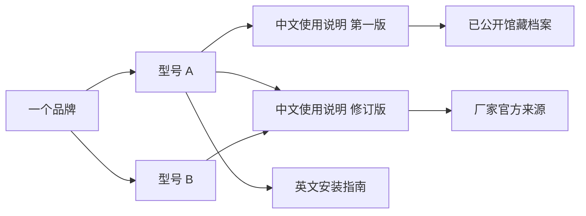

# 说明书专栏第一阶段详细设计

设计日期：2026年11月10日  
阶段：基础设计与样例  
配套：[总体方案](manuals-section-plan.md) · [开发阶段计划](manuals-development-plan.md) · [演示资料与查询场景](manuals-phase1-samples.md) · [验收清单](manuals-phase1-acceptance.md)

本阶段确定资料结构、页面布局、查询规则、维护步骤和后续改动范围，并提供独立的本地页面示意。正式功能在第二阶段开发，真实资料在后续经过批准后入站。

## 一 已确定的设计

专栏名称使用“说明书”，页面名称为“老旧默片说明书库”。访客无需登录即可查询和阅读；以品牌和准确型号为主，物件类别、语言和年代帮助缩小范围。

资料组织采用三种信息的关联：**品牌 → 产品型号 → 说明书文档版本**。搜索结果按型号收拢，进入后选择适合自己的语言、用途和版本；文档详情保留可直接分享的独立网址。

一份资料可以提供官方来源，也可以引用经过批准的馆藏阅读副本。列表始终写清“官网查看”或“站内阅读”，不让访客点进去后才发现没有全文。

首版新增资料通过本地管理入口维护，复用现有审核、历史与构建流程。本阶段不安装依赖，不新增数据库、线上服务或公开后台。

## 二 资料之间怎样关联

图中的修订版只有在厂家或说明书明确标注适用于型号 A 和 B 时，才同时关联。型号相似、照片相似、来自同一投稿人，都不能作为通用依据。

| 对象 | 记录什么 | 处理原则 |
| --- | --- | --- |
| 品牌 | 标准显示名、外文名及核定别名 | 品牌改名可保留别名；同集团品牌不自动合并 |
| 产品型号 | 所属品牌、机身完整型号、物件名称、品类 | 型号保留后缀；不同品牌的同名型号分别记录 |
| 文档版本 | 用途、语言、地区、修订信息、适用型号、来源、页序 | 同型号可有多份文档，一份通用手册只保存一次 |
| 正式档案 | 现有永久编号、正式元数据、发布图片和公开文字 | 继续由既有档案系统维护，专栏只引用 |

查询目录的 `brand_key`、`model_key`、`manual_key` 是功能标识，不是正式分类代码。拟采用 `brand-000001`、`model-000001`、`manual-000001` 等稳定值，不把题名、型号或年代编码进标识。更正属性时不改标识，也不改已有档案的永久编号。

实物说明书入藏仍按现有正式规范处理，当前原则上使用 `OTH` 与 `common`，不自行创建 `MAN` 或说明书专属维度。纯官方索引不分配虚构的 `LJM` 编号。

### 文档版本的边界

- 同型号的使用说明与安装指南是不同文档。
- 中文、英文等分别刊印的版本分别记录；同一本多语言手册使用一个文档及语言数组。
- 有实际修订的版本分别记录，显示修订日期和适用范围，不默认把最新版本当作所有产品都适用。
- 同一版本的清晰补扫不新增文档版本；更换引用前保存历史并重新审核。
- 无法确认是否同版时，保留独立候选，不自动合并；未知版本显示“版本未注明”。
- 纸本缺页后的补页属于原文档的补充候选，不能把自行拼接的内容标为原始完整版本。

## 三 字段与必填规则

首版把品牌、型号、文档三组信息存放在**同一个轻量目录文件**中，通过标识关联，无需另建数据库。

### 品牌和型号

| 字段 | 中文名称 | 必填规则 |
| --- | --- | --- |
| `brand_key` | 品牌标识 | 系统生成，唯一且稳定 |
| `name` | 品牌显示名 | 必填；不明品牌先存候选，不猜填 |
| `aliases` | 经核定的品牌别名 | 可空数组，不能凭相似读音补造 |
| `model_key` | 型号标识 | 系统生成，唯一且稳定 |
| `brand_key` | 所属品牌 | 必须引用现有品牌 |
| `model_text` | 完整型号 | 必填并保留原文，缺失时不标准确型号 |
| `model_aliases` | 经核定的型号写法 | 可空数组，只收有依据的等价写法 |
| `product_name` | 物件名称 | 必填，例如“电饭煲” |
| `category_key` | 查询品类 | 必填，使用本专栏的界面分类 |
| `product_era_display` | 产品年代 | 可空；没有依据不填，不能由接收日期推算 |

品类先沿用总体方案的五类：家用电器、影音与摄影、数码与办公、工具与设备、生活用品与装配。它们是查询界面分类，不写入正式档案代码字典。

### 文档信息

| 字段 | 中文名称 | 必填规则与用途 |
| --- | --- | --- |
| `manual_key` | 文档标识 | 系统生成，作为文档稳定网址的组成部分 |
| `model_keys` | 明确适用的型号 | 至少一个，有效标识数组；每个都要有核对依据 |
| `document_kind` | 文档用途 | 使用说明、快速入门、安装装配、保养、维修或用途未明 |
| `languages` | 原文语言 | 至少一项；无法判断明确选“语言未明” |
| `region_display` | 适用地区 | 必填显示文字，未知写“地区未注明” |
| `edition_display` | 版本说明 | 必填显示文字，未知写“版本未注明” |
| `edition_date` | 版本日期 | 有依据才填标准日期；只知道年份时保留在版本说明中 |
| `completeness` | 完整程度 | 完整、有缺页、完整度未核实；不得默认完整 |
| `missing_note` | 缺页说明 | “有缺页”时必填，能判断具体页码才写页码 |
| `linked_archive_id` | 关联正式档案 | 有站内阅读副本时必填；官方索引可以为空 |
| `official_sources` | 核定官方来源 | 地址、来源名称、最近核对日期和可用状态；可为多项 |
| `page_map` | 站内阅读页序 | 对应已公开附件的引用及纸面页码；没有副本为空数组 |
| `contents` | 阅读目录 | 可空；只指向实际可阅读的页序 |
| `keywords` | 公开查询关键词 | 可空数组，仅使用已经审核的公开文字 |
| `catalogue_summary` | 索引简介 | 仅用于纯官方索引；引用馆藏时读取现有公开简介 |

这些是拟议的功能字段。`completeness`、文档用途和查询品类不是 Excel 正式元数据代码，实施时使用清楚的功能值与中文标签，不扩写正式 schema。

馆藏题名从 `core.title` 读取，简介与已审文字从 `public_view` 读取，图片从 `core.publication_file_path` 读取。目录不复制保存另一份题名、图片或转录作为权威来源。

### 页序与目录

`page_map` 的每项引用一张确实属于所关联档案的已公开附件，并记录显示页名，如“封面”“印刷页 1”。不能通过自己写路径引入外部文件或主档。页序从 1 连续编号，纸面印刷页码可不连续，并单独显示。

目录项采用“标题＋阅读页序”，例如“部件名称 → 第 3 张”；目录目标必须存在。折页展开后仍是一张发布图时，标“折页”，不虚构拆出的印刷页。

只知道已经取得 12 张图片，不等于原书只有 12 页。页面显示“现有 12 张”，是否完整须另行核对。官方文件页数未核实就不显示页数。

### 私密记录

审核状态、型号适用依据、展示许可依据、人工批准记录、批准对应的资料版本、内部备注、历史和撤下原因保留在私密维护数据中。投稿者联系方式和账号归属继续由原有私密联系及账号系统保存，不复制到查询目录。

公开文件只生成经过批准的品牌、型号、文档及必要来源信息。下载能力、档案是否可见由既有公开状态和下载策略计算，不让目录填写一个“允许下载”值来覆盖原规则。

## 四 查询结果怎样组织

### 搜索与筛选

搜索框提示：“输入品牌、完整型号或物件名称”。下方固定提供“不知道型号在哪里？”帮助入口。首屏筛选只有品类、品牌、语言；更多筛选中再放文档用途、地区、年代、完整程度和获取方式。

以型号为结果分组单位，卡片先显示品牌与完整型号、物件名称，再列可用文档摘要。展开或进入详情后选择具体文档。同一通用手册可以出现在两个型号分组里，但“文档版本数”按文档标识去重。

“覆盖型号数”只统计至少有一种可用获取方式的型号；“文档版本数”对有效可用文档去重。草稿和撤下文档不参加公开计数。来源失效且没有站内副本的条目单列为暂不可用，不充当可用资料。

### 型号匹配规则

| 顺序 | 情况 | 展示文字 |
| --- | --- | --- |
| 1 | 品牌明确，完整型号或经核定等价写法吻合 | 准确型号 |
| 2 | 未限定品牌，完整型号吻合 | 型号吻合，请核对品牌；同名的不同品牌分别列出 |
| 3 | 仅型号片段吻合 | 型号包含该片段 |
| 4 | 只匹配物件名称、用途、关键词 | 关键词相关 |

大小写、全半角和多余空格可统一处理。连字符省略等写法先核对是否等价；只有无歧义或已确认别名时才作为准确匹配。不能把所有分隔符删除后强行认为同型号。

例如 `EX-RC100` 和 `EX-RC100A` 分别记录；查询前者时，后者不能标准确匹配。数字 0 和字母 O 不自动互换。不同型号只有说明书明确适用时才共享同一文档，不能凭同系列名称推断。

结果先按匹配类别排序，同类别按品牌、完整型号和稳定标识保持固定顺序；型号内按访客所选语言、文档用途、已知版本日期组织，未知日期不当作最新。同型号有多个版本时明确提示核对地区和版本。

### 无结果与故障

- 无准确型号但有相关资料：先写“暂未找到准确型号”，相关结果单独说明匹配原因。
- 完全无结果：保留查询词，提供放宽筛选、查找型号、请帮我找与补充线索入口。
- 查询索引加载失败：显示“查询暂时没有加载完成”，提供重试；不能误报没有资料。
- 官方来源失效：显示“官方来源暂不可用”，保留必要的来源核对信息，不跳到不明站点。
- 资料撤下或标识不存在：不返回正文、图片或下载地址，只显示“资料不存在或暂不可用”，提供返回查询入口。

## 五 页面与交互设计

### 查询页

桌面最大内容宽度沿用现有 1120px。顶部保留品牌和简洁导航，主区从上到下是标题、搜索、常用筛选、结果数量和型号条目。页面不增加轮播大图，首屏能够直接搜索。

每个条目包含：品牌与完整型号、物件名称、匹配原因、可用文档摘要、获取方式。纸本封面可以帮助辨认，但没有明确展示依据时使用中性图形，不复制厂商封面。

点击文档摘要进入 `/manuals/{manual_key}/`；返回时保留查询词、筛选和原列表位置。查询状态通过地址参数保存，避免只有当前浏览器才知道选了什么。

### 文档详情页

信息顺序固定为：

1. 返回查询、品牌与完整型号、文档用途和原文语言。
2. 明确适用型号、地区、版本、完整程度和缺页情况。
3. “开始阅读”或“前往厂家官网查看”主要按钮。
4. 站内阅读区或官方来源说明。
5. 同型号其他文档、来源与最近核对日期、纠错与补充入口。

同一文档适用多个型号时完整列出，不给每个型号复制一份正文。目录下明确区分版本日期与网站资料更新日期，未知不填“最新”。

仅官方索引不放一个空阅读器，不显示“站内下载”。具有站内副本与官方来源时，站内阅读为主操作，官方来源为次操作。

### 阅读区

桌面采用目录与页面并排：左侧目录约 200px，右侧显示单页，顶部提供上一页、下一页、页码选择和放大。放大时允许图像区域内平移，整张网页仍不横向溢出。关闭放大回到原页。

阅读页数显示“第 3 / 12 张 · 印刷页 1”。封面、空白页、折页按真实情况标注。首尾页禁用相应翻页按钮，目录目标缺失时不能跳转到错误页面。

页面状态可用 `#page=3` 表示第 3 张。无效值回到第一页并给出轻提示，不加载任意路径。只预取少量相邻页，长册不一次下载全部内容。

首版不新增整册 PDF 下载按钮。现有 `PD` 条件下的发布副本下载可以复用；其他权利状态继续遵守现行策略，公开展示本身也必须有相应依据。

### 手机布局

小屏单列显示，左右留白约 16px。搜索输入与查找按钮可换行；筛选折叠展开，已选条件在外部可见。型号完整换行，不截掉后缀。

详情页先显示适用范围和主要按钮，再显示阅读区。目录折叠，翻页与页码工具就近放置；触控操作区域至少约 44px。型号、页码和错误提示必须能用文字读懂。

当前网站其他语言入口不制造尚未开发的说明书地址；先提供明确标注的中文专栏入口。说明书原文语言与网站界面语言分别显示。

### 视觉取值

沿用现有米白背景 `#eee9de`、纸色 `#faf7ef`、深色文字 `#2c2823`、朱红强调 `#9a3f2e`。标题可以保留网站的宋体气质，型号、按钮和表单使用易辨认的无衬线字体。主操作使用一种强调色，不给每种品类分配装饰颜色。

状态使用文字配合图形：“站内阅读”“官网查看”“有缺页”“来源暂不可用”。首版不展示虚构下载量、热门排行或用户评价。

## 六 维护者怎样加入一份资料

本节确定第三阶段维护功能的使用方式，第一阶段只做流程设计。

1. 在本地管理入口选择“说明书目录”，新建条目，先选或新建品牌与型号。
2. 选择文档用途、语言、地区、版本和完整程度，补充明确适用的型号。
3. 选择“官方索引”时登记官方来源；选择“馆藏阅读副本”时关联已通过现有流程的正式档案。
4. 核对页序、纸面页码和目录，预览访客看到的页面。
5. 查看缺项和风险提示，完成型号、来源、权利与隐私人工核对后提交发布批准。
6. 正式发布生成公开目录，执行现有正式构建；全部通过后才切换到新结果。

馆藏尚未入站时，先按现有档案流程准备发布副本和草稿，不通过说明书目录旁路上传主档或绕过隐私确认。仅有封面、没有可用操作正文的条目可以保存候选，不能标作可站内阅读的说明书。

维护草稿状态依次为“编辑中、待核对、已批准、已发布”；退回或实质修改后重新核对。正式档案的 `ACT/G/U3` 状态仍由原系统管理，说明书目录批准不能覆盖它们。

## 七 发布与数据保存设计

### 公开条件

生成公开条目必须同时满足目录本版本已获人工批准、品牌和型号关系有效，以及至少有一种可用获取方式。输出馆藏正文和图片还必须满足关联档案现有 `ACT`、`G`、`U3` 条件、相应展示依据与附件检查。

官方索引有审核通过的型号与来源即可生成事实性目录，不能因此复制未获准的官方全文或封面。官方来源状态与馆藏阅读能力分别判断，一条来源失效不自动撤掉另一条经过批准的可用方式。

已发布条目修改前保存历史；审核对应本次内容，改型号、附件、正文或许可范围后重新核对。构建失败保留原可用结果。撤下时同步处理目录、索引与公开文件；从历史恢复只生成草稿。

### 拟定存储位置

下列位置用于指导后续开发，本阶段不创建真实目录、改环境变量或修改部署程序。

| 内容 | 拟定位置 | 管理方式 |
| --- | --- | --- |
| 品牌、型号、文档的维护数据与当前已批版本 | `adminDataRoot/manuals/` | 沿用现有私密数据根；本地对应 `local-admin/manuals/`，上线须映射持久数据根 |
| 草稿、审核、历史 | 同目录中分开保存 | 私密、不进仓库、不在网站响应中提供 |
| 网站读取的公开投影 | `site/src/data/generated/manuals-catalog.json` | 由批准记录生成，只含公开白名单字段，不人工编辑 |
| 档案与发布图片 | 现有 `archive-data` 和已审发布图片目录 | 不搬迁，不重新维护一套图片 |
| 本阶段虚构样例与页面示意 | 本机 `outputs/manuals-phase1/` | 已被项目忽略，不接入正式网站与部署包 |

目录文件保留 `schema_version`，首版按单个 JSON 文件的三组数组实现即可。目录标识与引用检查、公开投影函数适合集中在一个共享模块，不需要增加服务或数据库。

### 已核实的部署衔接

现有自动部署会从当前应用版本继承 `site/src/data/archive.ts`、图片与响应式清单，再调用 `local-admin/server.mjs --sync-site-data` 生成资料。新说明书目录尚未接入此流程。

因此后续必须从持久目录生成公开投影，不能只把一个本地 JSON 放进新代码版本并假设线上会保留。首次启用可明确建立空目录；已有目录丢失、版本不兼容或引用异常时应停止切换，不静默清空资料。

现有打包只明确排除了一批已知私密目录。新增 `local-admin/manuals/` 后，必须同时加入仓库忽略、部署排除及公开构建检查；私密审核数据不得随程序包进入新版本。账号和投稿服务的文件访问隔离也要随新增数据目录复核。

本阶段可预览文件在已忽略的 `outputs/` 中。设计规范仅以 Markdown 进入 `docs/`，符合现有纯文档变更识别方式；本次不提交或推送。

## 八 后续开发涉及的文件

| 位置 | 计划用途 | 预计阶段 |
| --- | --- | --- |
| 新增 `shared/manual-catalog.mjs` | 目录引用、字段和公开投影规则 | 二起，三补齐发布校验 |
| 新增 `site/src/pages/manuals/` | 查询、详情和型号帮助页 | 二 |
| 新增专栏查询与阅读脚本、展示模块 | 型号优先查询、结果分组与逐页阅读 | 二 |
| `site/src/layouts/BaseLayout.astro`、首页与界面文字模块 | 入口、样式和多语言链接衔接 | 二 |
| `local-admin/server.mjs` 与其本地界面 | 目录草稿、预览、发布与历史 | 三 |
| `.gitignore`、私密路径门禁、公开构建检查 | 新目录和样例不进入公开产物 | 二起，三完善 |
| `deployment/laojiumopian-github-deploy.sh` 及相关检查 | 持久数据、投影生成、打包排除和回退 | 三设计，四经授权上线 |
| 原账号和投稿模块 | 长册投稿、补页和归属 | 五 |

正式元数据 Excel、本地档案主库和现有永久编号不在本专栏功能开发的改写范围。具体新增文件名可在编码时细调，职责和数据边界以本设计为准。

## 九 本阶段交付与下一步

交付包括本设计、演示资料与查询场景、验收清单，以及本机可点击页面示意。原型只用预设虚构资料模拟查询、详情、阅读和异常状态；没有接入真实索引、账号、投稿、档案或发布程序。

第二阶段依照本设计实现可用的本地查询和阅读，并执行正式构建与功能验收。本阶段完成后停在设计交付，不自动进入第二阶段。
