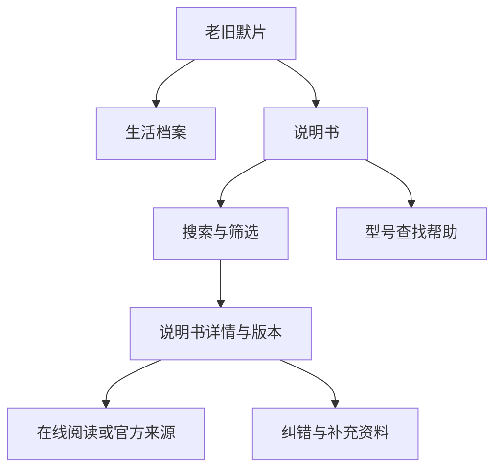

# 老旧默片说明书专栏网站方案

方案日期：2026年11月10日  
当前状态：第一阶段设计及第二阶段本地查询与阅读已开发；目录维护、真实资料入站与上线按后续阶段执行。

建议在“老旧默片”内开设独立的“说明书”专栏，收集新旧物件的操作资料，让访客按品牌、准确型号和版本快速找到可用说明书。资料组织采用“厂家官方资料索引＋经审核的馆藏发布副本”，网站继续使用现有技术、账号和人工审核流程。

这个方向可行。主要投入会是资料获取、型号核对、逐页整理和长期维护。首版应先验证几十条资料能否让人顺利找到、确认和阅读，再逐步增加品类和投稿能力。

## 一 可行性与定位

### 可行性的依据

说明书查询已有成熟使用方式：ManualsLib 的帮助页支持通过制造商、型号或分类目录寻找资料；海尔的具体产品页也提供对应型号的说明书入口。它们说明这种服务形式成立，但不能据此推算本专栏的访问量或收益。[ManualsLib 查询帮助](https://www.manualslib.com/faq.html)、[海尔产品说明书示例](https://www.haier.com/kitchen_appliances/xwj/20190513_91505.shtml)。

“老旧默片”适合从中文资料、早期国产物件、停产产品和家庭日用品逐步积累。新产品则可先整理准确的官方入口，让访客少花时间在不同厂商网站里寻找。老资料与新资料使用同一个检索入口，不设置年代准入门槛。

现有网站已有档案列表、详情、公开文字检索、图片浏览、账号收藏、投稿和私密联系入口，具备复用基础。新增专栏需要补充品牌与型号组织、版本核对、专栏检索和资料可用性维护。

### 推荐定位

- 专栏名称：**说明书**；页面完整名称：**老旧默片说明书库**。
- 页面说明：**按品牌、型号或物件名称，查找新旧物件的使用说明。**
- 主要用途：找到资料、确认适用型号、在线阅读、前往官方来源，以及在许可允许时获取发布副本。
- 内容侧重：操作、安装、装配、保养、快速入门等厂家原有资料。
- 首期运营：免费查询和阅读；保留投稿与纠错入口。

首版以资料查询为核心。问答社区、维修接单、付费下载和 AI 自动解答等扩展留待实际需求形成后另议。

### 主要使用场景

| 使用者的情况 | 应提供的帮助 |
| --- | --- |
| 家中电器说明书丢失，知道品牌和型号 | 优先找到准确型号，并核对版本与适用范围 |
| 买到二手相机、音响或旧家电 | 提供年代不限的资料，显示语言、缺页和来源情况 |
| 只知道“某品牌电饭煲”，不知道型号 | 先按品类和品牌缩小范围，再提示去机身铭牌查型号 |
| 有旧说明书，希望保存或分享 | 提供清楚的资料线索与投稿入口，审核后再收录 |

## 二 内容范围与首批资料

### 分类方式

先按“物件是什么”分类，再用品牌和型号查找；年代作为辅助筛选。

| 一级分类 | 可收录的物件举例 |
| --- | --- |
| 家用电器 | 冰箱、洗衣机、空调、电饭煲、风扇、吸尘器 |
| 影音与摄影 | 收音机、录音机、音响、电视、相机、摄像机 |
| 数码与办公 | 打印机、扫描仪、电脑外设、计算器、电子词典 |
| 工具与设备 | 缝纫机、电动工具、测量工具、家用小设备 |
| 生活用品与装配 | 钟表、自行车、家具、玩具及装配用品 |

首批从手头资料最完整、型号最明确的两至三个分类开始。没有资料的分类不显示空栏目；现代产品与旧物件都可以加入，不为凑分类扩大采集范围。

每份资料另标“使用说明”“快速入门”“安装或装配”“保养”等文档用途。维修手册与普通用户说明要明确区分，不把维修步骤当作一般操作指南。

### 首批规模与选择顺序

建议以 **30—50 条有效资料**为试运行目标，数量是建设建议，不代表已有库存。每条必须至少提供一种真实可用的获取方式：可访问的官方来源，或经过审核的本地阅读副本。

优先顺序是：型号明确且完整可读的现有资料、常见家庭物件的官方入口、难以查找且已有合法展示依据的旧说明书、用户反复寻找的型号。只有封面、型号不清或缺少关键操作页的资料可以保存为候选，不能用来充当“完整说明书”。

暂不批量采集其他说明书网站的文件。已有本地说明书的实际数量、完整度和权利条件，需要在后续资料盘点阶段单独确认。

## 三 网站入口与页面结构

### 与现有网站的关系

主导航增加“说明书”，形成“档案｜说明书｜关于｜我要投稿｜登录”的入口关系。首页增加一个简短的说明书入口，点击后直接进入查询页面。沿用现有域名和网站品牌。



### 页面安排

下列地址为拟定结构，开发时再结合现有路由核定。

| 页面 | 拟定地址 | 主要内容 | 阶段 |
| --- | --- | --- | --- |
| 专栏首页与查询结果 | `/manuals/` | 搜索框、筛选、资料列表、查型号帮助 | 首版 |
| 资料详情 | `/manuals/{key}/` | 适用型号、版本、阅读区、来源、纠错 | 首版 |
| 型号查找帮助 | `/manuals/help/` | 铭牌位置示意、型号与序列号的区别 | 首版 |
| 品牌与分类目录 | 首版在查询页内提供 | 点击后应用相应筛选 | 首版 |
| 独立品牌与分类页 | `/manuals/brands/{brand}/` 等 | 在资料充足时生成可分享的目录页 | 后续 |
| 投稿与寻找请求 | 连接现有投稿、私密联系入口 | 提供资料线索、补页、请求寻找 | 首版复用入口，后续增强 |

搜索词、品牌、分类和语言等筛选写入网址，例如 `/manuals/?q=品牌+型号&language=zh`，方便分享、后退和再次打开。首次进入不显示复杂表单。

### 首页示意

```text
老旧默片   档案   说明书   关于   我要投稿   登录

说明书库
按品牌、型号或物件名称，查找新旧物件的使用说明

[ 输入品牌、型号或物件名称                    ] [查找]
不知道型号在哪里？查看查找方法

分类 [全部]   品牌 [全部]   语言 [全部]   更多筛选

找到的资料
品牌与完整型号                 中文 · 使用说明 · 官方来源
品牌与完整型号                 中文 · 使用说明 · 可在线阅读
品牌与完整型号                 日文 · 安装说明 · 缺少部分页面

最近收录     按分类浏览     提供说明书线索
```

以上只是页面结构示意，不代表已收录这些资料。首页不使用轮播大图占据搜索位置；品类不足时，以搜索和现有资料列表为主。

## 四 搜索与型号核对

### 搜索规则

支持品牌中文名、外文名、人工核定的旧名、完整型号、型号片段、物件名称和公开关键词。忽略大小写、全半角和多余空格；连字符等格式差异可以辅助匹配，原始型号原样显示。

排序优先级依次为：品牌与完整型号吻合、完整型号吻合、经人工核定的适用型号、型号片段、标题和品类关键词、公开说明文字。排序应有稳定次序，结果同时解释“准确型号”“同系列资料”或“关键词相关”。

型号中有实际含义的后缀必须保留。“AB-100”和“AB-100A”不能因为相近就被判断为同一型号；数字 0 与字母 O 等疑似误输只提示核对，不自动替换。系列通用说明书的适用型号必须来自说明书或厂商明确列出的范围。

### 筛选与无结果处理

首屏提供分类、品牌、语言；展开后可选择文档用途、年代、完整程度、获取方式和地区版本。默认展示全部年代，不要求访客先知道产品年份。

无结果时显示“暂未收录准确型号”，保留输入词，提供放宽品牌或品类筛选的方法，以及“请帮我找”和“我有资料可以补充”入口。相近型号另列为参考，并显示型号差异。

首版搜索覆盖品牌、型号、标题、用途、简介和已审核的公开文字。整本扫描件中的文字不会自动变成可检索内容；只有完成提取、核对和隐私检查的文字才可加入索引。

## 五 详情与阅读体验

### 详情页的信息顺序

1. **品牌、完整型号与说明书标题**，紧接着显示资料用途和语言。
2. **适用范围**，列出明确支持的型号、地区、版本与影响使用的差异。
3. **主要操作**，按实际条件显示“在线阅读”“前往厂家官网”或允许的发布副本下载。
4. **目录与阅读区**，可按页查看；仅官方索引条目则突出来源入口。
5. **来源与资料状态**，包括版本日期、完整程度、来源类型、最近核对日期及必要的缺页说明。
6. **同型号其他文档与纠错入口**，使用说明、安装说明、其他语言版本分别列出。

### 扫描件阅读

本地资料首版采用逐页图片，支持上一页、下一页、页码跳转、缩略图和放大。手机端优先显示阅读区，工具保持简洁，返回查询时保留筛选条件。只加载当前页与少量相邻页，长册不一次下载全部图片。

扫描顺序与纸面印刷页码分别记录，例如“第 6 张，对应印刷页 4”；封面、封底、折页和空白页明确标记。缺页保留可读说明，不重新编号造成“全册完整”的印象。

关键小字、电气参数和警示内容必须能放大看清。发布图片以实际阅读效果为准，不把文件大小压缩到影响辨认。已有公开文字可以作为辅助阅读；疑读和缺失应明确标示，不能补写产品操作步骤。

### 官方来源资料

只做官方索引时，显示品牌、型号、语言、文档用途、可核实的版本信息和最近检查日期，按钮写“前往厂家官网查看”。没有站内全文时，列表与详情均要如实标明。

优先链接厂商的产品支持页，必要时同时提供其官方文件链接。链接失效后保留型号与来源记录，标记“来源暂不可用”并人工复查，不自动换成不明下载站。

## 六 资料组织与现有档案规范

### 一份资料怎样计数

一本完整说明书是一个文档版本，封面与内页不分别算多本。同一产品的使用说明、安装指南、不同语言或实质不同的修订版分别作为文档版本，并在型号下关联。

一份通用手册可以关联多个明确适用的型号，文件只保存一份。同版本的较清晰补扫作为替换候选处理，审核后保留历史；不因增加型号、修改品牌别名或更新展示顺序而重新分配永久档案编号。

专栏统计分别显示“覆盖型号数”“说明书版本数”，必要时再分“可站内阅读”和“官方索引”。同一个型号的三个版本不能宣传为覆盖三个型号。

### 档案数据与查询资料的关系

现有正式类型没有“说明书”独立代码。实物说明书如进入馆藏，原则上使用现行 `OTH` 与 `common`，具体仍以正式 Excel 规范和实际资料为准；不自行增加 `MAN` 等代码，不改变已有编号含义。

正式档案继续采用 `core`、`metadata`、`public_view`。为查询增加的品牌、型号和版本关系，建议放入一个轻量的“说明书查询目录”，通过 `item_id` 引用正式档案，不另抄写一整套档案元数据。此目录是拟议的专栏功能数据，不是 Excel 正式分类编码，字段须在开发阶段明确后再实施。

纯官方索引条目使用独立的查询目录标识，不假装拥有实物，也不为了生成页面而虚构 `LJM` 档案编号。已有馆藏的标题、图片和公开文字从正式发布记录读取；若该档案撤下，目录不得继续输出其图片、文字或下载路径。

### 需要记录的信息

| 信息组 | 内容 | 公开与维护原则 |
| --- | --- | --- |
| 产品识别 | 品牌、品牌别名、完整型号、适用型号数组、物件分类 | 必须有依据；型号不明不得标准确匹配 |
| 文档版本 | 文档用途、语言、地区、版本号、版本日期 | 未知如实标未知，不用收录日期代替 |
| 阅读信息 | 页序、印刷页码、完整程度、缺页说明、目录 | 本地阅读必须核对；官方资料页数未知可留空 |
| 档案关联 | 查询目录标识、关联 `item_id` | 档案字段和正式编号仅在原档案系统维护 |
| 来源与可用性 | 官方来源地址、来源类型、最近核对日期、可用状态 | 公开必要来源；不公开提交者联系方式 |
| 发布依据 | 权利依据、展示范围、下载范围、审核结论 | 依据和审核记录私密保存，页面只显示必要状态 |
| 查询辅助 | 人工核定关键词、公开摘要、品牌别名 | 多值使用数组；只能索引已审核公开内容 |

资料年代、产品年代、说明书版本日期与接收日期分别记录。年代无法判断时仍遵守现有 `date_display` 填“年代未知”的规则。

## 七 收录方式与审核流程

### 三种来源

**已有纸本或馆藏资料。** 先核对资料与权利，再由档案所有人另行准备筛选、压缩、必要脱敏的图片副本。仍只从 `public-assets/inbox/` 接收图片，主档始终保留在独立档案系统。

**厂家官方资料。** 首先登记可核实的官方入口和型号信息。网站只保存查询所需的事实性信息；如需复制全文、封面或整本文件，再核对具体许可。厂商发布了文件，不等于本站已取得转载许可。

**用户提供资料。** 首版沿用现有私密收件与人工审核机制，接收资料线索和当前允许的图片副本。后续再补充品牌、型号、页数、语言、来源和授权范围等专用填写项。

### 本地阅读资料的发布顺序

确认来源与版本 → 查重和型号核对 → 准备发布副本 → 逐页核对清晰度、顺序和缺页 → 权利与隐私检查 → 保存草稿 → 用户人工批准 → 通过正式发布与构建检查 → 验收检索、详情与阅读。

用户投稿先进入私密收件区，不直接进入公开目录。初审、转档案草稿和正式发布仍经过既有门禁。审核意见、联系方式、授权凭证和账号归属不进入公开查询目录或搜索索引。

### 长册与 PDF 的现有限制

当前投稿每次最多 8 张图片，每张 5 MB、合计 20 MB，允许 JPG、PNG、WebP；不能直接上传 PDF。前述限制来自现有代码，不能把未来能力写成已具备功能。

首版可由维护者通过本地整理流程制作长册阅读副本；公开投稿入口先清楚说明限制，接受线索或少量补页。后续若建设长册投稿，应单独处理分批上传、断点继续、整册归并、页序、容量和私密暂存，不把每 8 页拆成不同说明书。

PDF 接收、处理与站内下载作为单独阶段评估。该阶段需要明确私密暂存、文件检查、批注和隐藏信息检查、发布副本制作及公开构建规则；涉及新依赖或服务时按项目规则事先说明并取得授权。

## 八 权利隐私与使用提示

### 发布依据

持有纸质说明书、资料年代久远、网上可以免费下载，都不能单独作为本站公开全文的依据。著作权法区分作品原件所有权与著作权，并规定复制、网络传播及使用限制；个人学习使用的规定不能直接当作建立公开全文库的许可。具体资料需核对授权或其他适用依据。[著作权法第十条、第二十条、第二十三条及第二十四条](https://www.nsfc.gov.cn/p1/2871/2872/69475.html)。

推荐按以下规则收录：

| 情况 | 网站处理 |
| --- | --- |
| 官方来源可核实，尚未取得本站全文发布依据 | 提供型号目录和官方来源链接 |
| 已明确取得展示许可 | 在许可范围内展示，并保留私密凭证 |
| 已核验公版或适用的开放许可 | 按实际范围提供阅读和允许的下载 |
| 来源、型号、权利或隐私不确定 | 保持候选状态，不自动公开全文 |
| 权利人提出具体异议 | 通过现有纠错与撤下入口受理，保存处理记录 |

现有下载策略只对 `PD` 开放发布副本下载，`LIC` 当前也不自动开放。首版沿用该限制；如需按具体许可增加下载能力，另行设计并验收，不能仅加一个下载按钮绕过现行规则。PDF 的展示与获取同样需要覆盖相应范围的发布依据。

### 隐私要求

说明书可能夹有保修卡、购买人姓名、电话、私人地址、手写签名和账号绑定信息；出现敏感内容或无法判断时，必须停止自动入站，交由用户人工判断。二维码也可能含注册或个人信息，不能只检查肉眼可见文字。

面向企业公开刊印的信息，如历史客服电话，仍按当前项目隐私检查流程核定，不擅自认定可以放行。展示历史联系方式时应明确年代，不把旧维修网点或旧电话推荐为现行服务入口。既有批次的隐私特批不适用于本专栏新收录资料。

下载限制只是网站的功能和授权范围表达，不能作为防止他人复制内容的保护手段；是否可以展示全文仍要在公开前解决。

### 使用提示

涉及不同地区电压、燃气、儿童用品、拆机和维修的内容，详情页应突出适用范围和资料版本。旧说明书作为原始文献保留，重要安全信息应引导核对厂家现行说明；整理人员不改写或补造厂家操作步骤。

## 九 视觉与手机体验

沿用网站现有的米白色底、深色文字和品牌字体，查询控件与正文使用清晰易读的排版。资料列表采用紧凑条目，完整型号醒目显示；封面作为帮助辨认的辅助图，不占主要空间。

“可站内阅读”“官方来源”“缺页”用文字明确说明，并辅以颜色或图标。按钮直写动作，不使用模糊的“获取资源”。图片加载失败、索引加载失败和来源失效分别给出可理解的提示。

手机页面先显示搜索框，再显示资料；筛选可展开，阅读操作靠近正文。支持键盘操作、可见焦点、足够大的点击区域和清楚的表单标签。帮助页用自制示意图说明型号位置，不采集普通人的机身照片来推断身份。

## 十 技术实现与现有功能复用

### 首版选择

继续使用现有 Astro 网站，生成静态页面和只包含公开字段的搜索索引，浏览器完成筛选和排序。图片阅读沿用已有图片展示基础，增加适合说明书的页码与目录操作。账号、收藏、联系和审核尽量接入现有流程。

先用简单文件保存小规模说明书查询目录，不为几十条资料新增数据库、搜索服务、后台系统或云服务，也不安装新 Node.js 包。数量增长后根据实际索引大小和手机性能决定是否需要分片等改进。

现有收藏以档案为对象。关联正式档案的说明书可以评估复用；纯官方索引首版可复制链接或使用浏览器收藏。若要将索引条目也纳入账号收藏，需要单独设计标识和权限，不能伪造档案编号接入。

### 需要适配的现有模块

| 模块 | 计划调整与检查重点 |
| --- | --- |
| 导航与首页 | 增加专栏入口，手机布局能容纳，保留原页面路径 |
| 查询与索引 | 品牌和型号优先匹配，公开字段白名单，错误提示与重试 |
| 阅读与图片 | 页序、缺页、清晰度、按需加载，复用图片访问规则 |
| 本地维护入口 | 分阶段增加目录编辑和关联；仍仅在本机运行 |
| 投稿与联系 | 首版复用已有入口，后续再增加长册专用字段和上传 |
| 发布与部署 | 将新目录、页面和资产纳入现有校验、数据同步与构建流程 |
| 纠错与撤下 | 撤下后同步移除展示内容、索引和可访问文件入口 |

目录编辑、来源凭证和新附件类型都属于未来实现范围。开发时必须检查现有部署的资料继承和保护规则，避免本地生成的新目录在部署时丢失，或旧资料因更新被覆盖。

### 多语言与搜索引擎

首版以中文查询体验为主，说明书原有语言照实标注。现有其他语言页面应提供明确的中文专栏入口或隐藏不可用链接；没有对应页面时，不生成虚假的语言切换地址或多语言收录声明。

每份资料生成稳定详情网址，标题包含品牌、完整型号、用途和语言。搜索引擎优先收录详情和有实际资料的目录页；任意搜索词和筛选组合不批量生成重复页面。网页保留来源与实质更新信息，撤下资料按既有撤下规则处理。

## 十一 日常维护与运营

### 维护节奏

初期每周集中整理一批新增资料和纠错，按能力决定数量。每月检查官方链接可用性、重复条目、阅读问题和分类积累；来源页面发生变化后重新核对型号与版本。

起步用本地检查清单即可，不要求新建监控服务或定时任务。以后确有必要，再在用户授权后增加周期检查。资料撤下或替换按项目历史、回收和构建规则执行，不永久删除既有图片。

来源核验时间与页面更新日期分开记录。修改型号或适用范围要留修订说明；发现将资料关联到错误型号时，优先暂停相应入口，再修正并重新验收。

### 找不到资料的处理

“请帮我找”通过现有私密联系入口收集品牌、完整型号、品类和希望的语言，联系方式保留在私密联系系统。无需为提交寻找请求强制注册。首期按实际能力回复，不承诺一定找到或固定处理时限。

需要展示求助列表时，只能从请求中人工整理必要的公开产品信息，另行确认发布；不能自动公开留言、账号、联系方式或设备序列号。

### 衡量是否有用

优先观察覆盖的准确型号、可用阅读或来源比例、错型号反馈、失效链接、缺页情况，以及访客能否在少量步骤内找到资料。初期可通过人工任务和私密反馈评估，不默认增加第三方跟踪工具。

后续若统计阅读、搜索或下载行为，先明确实际用途、收集字段与保留期限。搜索无结果率只有在真实收集并正确区分搜索行为后才可报告，不能把页面访问量直接当作成功查询量。

## 十二 工作量与容量估算

以下均为方案假设，用于安排工作；不是已测数据、服务商报价或工期承诺。

### 主要投入

网站继续使用现有域名与服务器，首版不强制新增付费服务。新增资料仍会增加存储、传输和维护成本，实际是否产生费用取决于现有资源余量与服务商计费。

资料整理通常比页面制作更持久。对一份约 20 页、已有清晰电子副本的说明书，可先按 30—90 分钟安排型号、页序、隐私和元数据核对；需要重新扫描、脱敏或确认授权时另计。先整理 3—5 本实测，再修订估算。

### 容量举例

| 假设 | 估算结果 |
| --- | --- |
| 100 本，每本 20 页，每页平均 0.25 MB | 页面图片约 500 MB |
| 1000 本，其余假设相同 | 页面图片约 5 GB |
| 每月 1 万次阅读，每次平均传输 3 MB | 月传输约 30 GB |

以上按十进制容量计算，只是对应假设的乘法结果。缩略图、其他尺寸、历史版本和备份需要额外空间；官方链接条目不承担整本图片容量。实际发布前用样本测量体积和手机阅读流量。

## 十三 分阶段实施

具体工作内容、交付物和验收条件见配套的[说明书专栏开发阶段计划](manuals-development-plan.md)。每次只实施用户确认的一个阶段。下面的相对工作量只涵盖开发与检查，真实资料准备、授权核实和用户验收时间另计。

| 阶段 | 主要交付 | 估算工作量 | 阶段完成条件 |
| --- | --- | --- | --- |
| 本次方案与计划 | 定位、页面、资料规则、技术路径和分阶段交付要求 | 本次交付 | 形成可审阅方案，尚未进入开发 |
| 阶段一 基础设计与样例 | 字段关系、页面布局、演示样例和验收清单 | 约 1—2 个开发工作日 | 查询和资料组织方式清楚，样例与正式数据隔离 |
| 阶段二 本地查询与阅读 | 查询首页、详情、图片阅读、型号帮助和现有入口衔接 | 约 3—5 个开发工作日 | 本地查询与阅读验收、正式构建通过 |
| 阶段三 本地维护与发布检查 | 目录维护、草稿、预览、发布校验与历史撤下衔接 | 约 2—3 个开发工作日 | 安全加入、更正和撤下资料的流程通过验收 |
| 阶段四 首批资料与正式上线 | 30—50 条目标资料、逐条审核、正式构建、上线与回退 | 约 1—2 个技术工作日，整理另计 | 准备验收通过，取得对应线上授权后部署并核验 |
| 阶段五 说明书专用投稿 | 结构化填写、长册分批上传、页序与人工审核衔接 | 复核上传链路后另行估算 | 长册投稿到人工发布流程完整，私密隔离通过 |
| 阶段六 按需求增强 | PDF、已核对全文检索、索引收藏等按需择项 | 单项确认后估算 | 每项均有真实需求、授权范围和验收结果 |

首版前四阶段合计约 7—12 个开发工作日，是工作量估算，资料整理与验收等待另计，阶段一后根据实际范围修订。阶段四的正式线上发布须取得对应线上操作授权。方案确认和本地开发不等于批准生产部署；后续各阶段也不因列入本方案而自动启动。

首版试用样例须明确为演示，不借用真实档案编号或未经批准的真实资料填充页面。实际资料不足时可缩小首批数量，先满足可用与准确要求。

## 十四 验收标准

### 查询与使用

- 准备至少 20 个经人工核定的测试查询，覆盖准确型号、品牌别名、格式差异、型号后缀、系列文档和不存在的型号。
- 测试集中已收录且品牌明确的准确型号应出现在首位；无品牌的同名型号应清楚区分。
- 相近型号不得标“准确匹配”；不存在的型号应进入清楚的无结果流程。
- 从列表进入详情，再打开阅读或官方来源，操作路径清楚；返回列表后筛选条件仍在。
- 电脑和手机均能搜索、筛选、阅读、翻页与放大；键盘可操作主要控件。

### 资料质量

- 每条资料均有可用获取方式、明确型号依据、语言、用途和来源；未知版本如实标示。
- 扫描页序与印刷页码核对完成，完整程度与实际一致，关键操作及警示文字可辨认。
- 同一版本不重复存多套；通用手册的适用型号可追溯到资料依据。
- 站内全文有发布依据；下载按钮符合现有权利策略，不默认扩大授权。

### 隐私与发布

- 待审资料、投稿联系方式、账号信息、内部备注和授权凭证不出现在页面、索引或部署文件中。
- 原始主档未被修改或复制进网站；新图片来自批准的 inbox 发布副本。
- 档案类型、schema、字段、图片路径和编号关系检查通过。
- 撤下条目后，相关详情、索引与文件入口同步处理，恢复只生成草稿。
- 在 `site/` 执行现有正式 `build` 并通过公开构建检查；原有档案、投稿、账号和多语言导航回归通过。

### 性能目标

以一台普通手机和固定网络条件建立基线，建议目标是首屏可用时间约 3 秒内、索引加载后常规筛选响应约 300 毫秒内。目标须通过实测判断；超标时先优化图片、加载方式和索引组织，不先增加外部服务。

长册首次打开不得下载全部页面；无站内全文的条目不加载无关图片。测试结果保留设备、网络、样本体积与失败情况，避免只报告最快一次成绩。

## 十五 下一阶段建议

第一阶段已交付[详细设计](manuals-phase1-design.md)、[演示资料与查询场景](manuals-phase1-samples.md)和[验收清单](manuals-phase1-acceptance.md)。第二阶段已开发搜索、筛选、详情、逐页阅读和官方来源入口，详见[第二阶段验收记录](manuals-phase2-review.md)。下一阶段按[开发阶段计划](manuals-development-plan.md)完成本地维护与发布检查，首批真实资料和上线仍分阶段推进。

本次停留在第二阶段本地功能交付。真实说明书盘点、入站、本地维护发布和线上部署分别按后续明确指令执行。

## 项目依据

- [项目协作与档案保护规则](../AGENTS.md)
- [真实藏品入站流程](intake-sop.md)
- [网站发布前隐私检查表](privacy-checklist.md)
- [正式元数据规范](reference/archive-metadata-standard-v1.xlsx)
- [当前档案类型定义](../site/src/data/archive-schema.ts)
- [当前公开搜索索引](../site/src/data/archive-search-index.ts)
- [当前下载策略](../site/src/data/archive-rights.ts)
- [当前投稿限制](../local-admin/submissions.mjs)

外部事实依据的查询日期为2026年11月10日；品牌入口与政策内容可能更新，实际收录与上线前需按具体资料重新核对。
